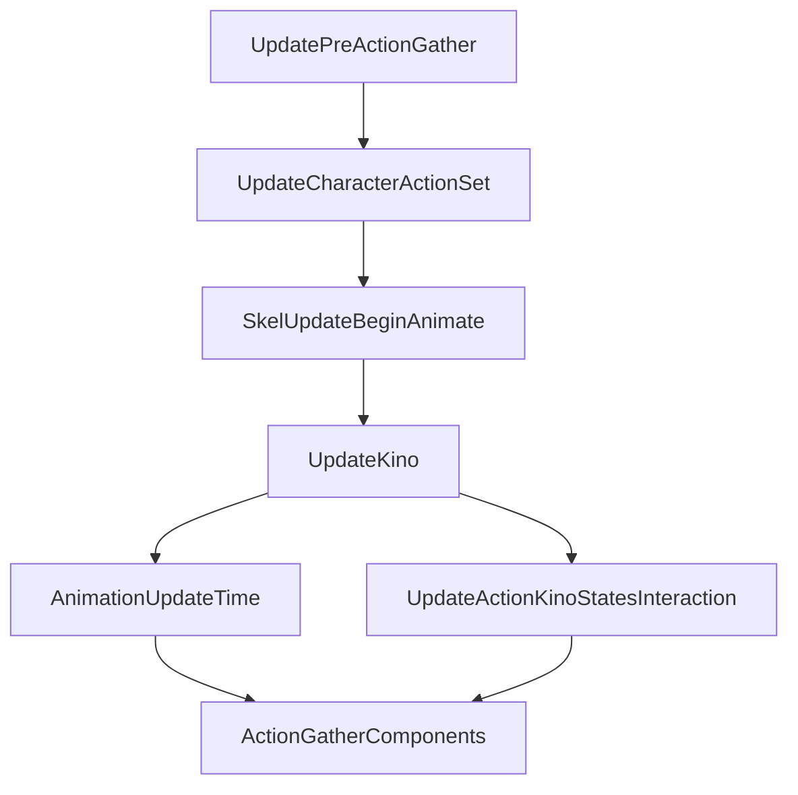

# Animation-time completion in the action graph

Seven registrations connect the animation membership gather to animation-time execution and the later action gather. This extends the previously verified action-gather-to-physics route upstream. Under ordinary active dependency semantics, the action gather waits for animation-time worker completion, not just its remaining count reaching zero.

## Recovered partial topology



`UpdateKino` also has the profiler label `WorldTasks::KinoPreGraphsStep`. This is the manager callback previously distinguished from component time updates. It precedes the `AnimationUpdateTime` receiver job; these are separate tasks.

The arrows are registered prerequisites. They do not imply a fixed execution order between the two branches, equal receiver populations, common clock values, or one invocation per physics substep. There may be additional incoming or outgoing dependencies outside this partial graph.

## Completion and reuse consequence

The selected animation range job uses ordinary execution accounting and finalization. Its remaining count can reach zero before callbacks run, but releasing its outgoing dependency requires its dispatched worker bodies to return. Consequently, `ActionGatherComponents` retains the animation branch's hold until that finalization occurs. Completing the interaction branch alone cannot release the gather.

The earlier action/physics analysis connects `ActionGatherComponents` to bone-update branches, the pre-simulation chain, physics completion and the action terminal. The [EndFrame audit](ENGINE_LOOP_HANDSHAKE.md) connects that terminal through the enabled ordinary frame topology to the next dependency preparation and root submission. Combining these inspected routes establishes a conditional ordinary ordering:

```text
animation-time receivers and their worker contexts return
    -> animation job finalizes and releases its successor hold
    -> action gather, once all its other holds are released
    -> downstream action/physics work and action terminal
    -> ordinary downstream frame completion
    -> EndFrame prepares and submits the next root
    -> next selected pre-action gather may copy receiver storage
```

This closes the missing animation-job join to the existing ordinary reuse argument. A yielded worker with positive remaining work does not by itself satisfy completion. A fully claimed job with a still-running worker also does not satisfy it. No new unconditional reset is needed to explain the ordinary path.

This is not a universal barrier. Alternate dependency release, startup, direct invocation, faults, dynamic topology changes and event modes retain their existing limits. The live player's world and membership remain unverified. EndFrame can submit another root before its own bookkeeping returns, so this ordering does not imply that the whole engine is idle.

## Executable inspection example

Run from the repository root:

```sh
python3 -m engine.examples.animation_stage_probe
```

The [graph fixture](../../engine/examples/animation_stage_graph.json) contains the seven job identities, kinds and edges. The [probe](../../engine/examples/animation_stage_probe.py) runs it through the independent mixed scheduler with synthetic receiver lists and no-op bodies. It holds two animation dispatches open after both ranges have been claimed, completes one and then the other, and reports the downstream gather's holds/request counters at each stage.

Expected observations include:

| Observation | Animation remaining | Animation executions | Gather holds |
| --- | ---: | ---: | ---: |
| Both branches pending | 2 | 0 | 2 |
| Interaction returned | 2 | 0 | 1 |
| Both animation ranges claimed | 0 | 2 | 1 |
| First animation dispatch finished | 0 | 1 | 1 |
| Second animation dispatch finished | 0 | 0 | 0 |

The two-dispatch limit, synthetic populations and manual interleaving are test choices. They are not recovered game configuration. The fixture stops at action gather and does not replace the complete frame graph or execute gameplay/animation bodies.

## Evidence and checks

Original setup instructions for all seven registrations were executed in isolation with two synthetic owner bases, constructor-matched virtual tables and a recording stub for the dependency registration method. Source and successor identities matched the fixture. The stub deliberately clobbered volatile registers between calls. The [receipt](animation_dependencies_validation.json) records this scope. The established downstream action/physics exports and nine bridge/table anchors were also rechecked against the same image.

Two new repository tests check both-branch reconvergence and the distinction between zero remaining work, body return, and dispatch finalization. They test the independent scheduler example, not native concurrent scheduling.

Static anchors, all relative to the same scheduler owner:

| Predecessor | Successor | Registration call |
| --- | --- | --- |
| `0x1d8` pre-action gather | `0x2950` character action | `140908176` |
| `0x2950` character action | `0x57b0` skeleton begin | `140908191` |
| `0x57b0` skeleton begin | `0x3938` Kino pre-graph | `1409081ab` |
| `0x3938` Kino pre-graph | `0x3af0` animation time | `1409081b7` |
| `0x3938` Kino pre-graph | `0x3050` interaction state | `1409081ce` |
| `0x3050` interaction state | `0x2798` action gather | `1409081ec` |
| `0x3af0` animation time | `0x2798` action gather | `1409081f8` |

The setup saves its original owner at frame+`0x9f0`. RDI holds owner+`0x3af0` from `1409076a5` until these registrations complete; RSI has already advanced by `0xff8` and is not the owner base here. Constructor `1408aff20` installs callback table `141e89618` for the three callback jobs and range table `141ec7f38` for the four range jobs. Both tables select registration method `1411e1790` at slot `0x10`. The range table's ordinary finalizer and worker are the ones already inspected in the claim and scheduler lifecycle guides.

Next useful live evidence is an observation of these named jobs' request, hold, execution and completion counters in the selected world. Hooking or controlling this path still requires validating native thread context and the effect of stopping progression on engine services.
