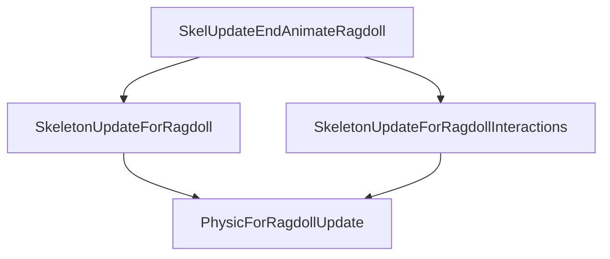
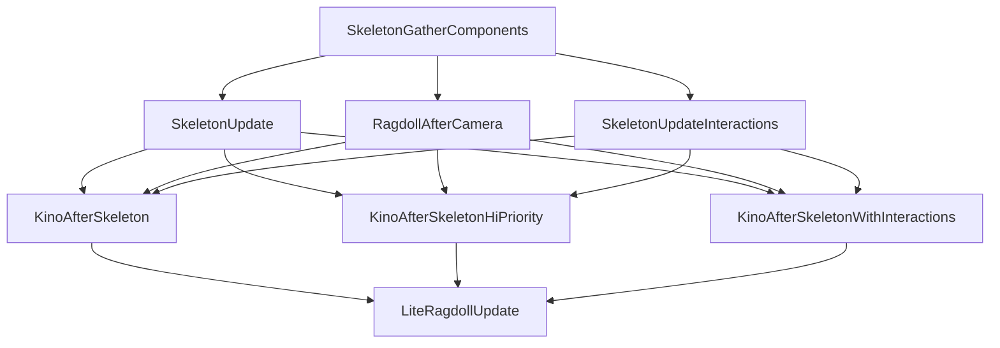

# Ragdoll pose-update completion

Four original registrations establish this partial graph:



The interaction branch contains the skeleton batch whose bank rotation and update
were traced in [the pose writer analysis](CENTRAL_IMPULSE.md#ragdoll-jobs-are-additional-skeleton-pose-writers).
These arrows are registered dependencies. They do not prove the current player is
in either branch, define the entire frame graph, or imply that the two branches
run serially.

## Concrete job types

All four nodes use the established range-job predicate, worker, begin and ordinary
finalizer. The interaction node has a different concrete visitor: it visits entries
in reverse order and calls a stored callable with an entry address. The ordinary
visitor loads each entry's pointer and invokes its stored function directly.
Therefore the interaction node must not be modeled as a once-per-job callback
merely because setup assigns a callable wrapper. Its entries can represent batches;
this pass does not reconstruct their producer or prove their contents.

The constructor installs the special interaction table after the common job base.
The remaining three nodes use the ordinary range table. The dependency registration
slot is identical across both tables. Original setup instructions were executed
with two synthetic owner bases and constructor-matched tables; the four recorded
edges match the fixture. The registration stub clobbers volatile registers between
calls. See the [validation receipt](../../native/snow_host/ragdoll_dependencies_validation.json).
This validates the registration arguments, not native dependency mutation or a live
scheduler run.

## Runnable completion experiment

```sh
python3 -m engine.examples.ragdoll_stage_probe
```

The [fixture](../../engine/examples/ragdoll_stage_graph.json) and
[probe](../../engine/examples/ragdoll_stage_probe.py) use the independent scheduler
with synthetic entries and no-op bodies. Either skeleton branch can be delayed.
The expected join holds are:

| Stage | Join holds | Delayed executions |
| --- | ---: | ---: |
| Both branches pending | 2 | 0 |
| Other branch finished | 1 | 0 |
| Delayed range fully claimed | 1 | 1 |
| Delayed body returned, dispatch unfinished | 1 | 1 |
| Delayed dispatch finalized | 0 | 0 |

Tests exercise both choices of delayed branch. Zero remaining-to-claim is not a
completion signal. Under the reconstructed ordinary finalization semantics, the
physics-for-ragdoll successor cannot start until both skeleton branches finalize.
Additional incoming holds in the full graph can delay it further.

## What this gives the capture API

This identifies a join that follows the interaction writer on the inspected path.
It is a candidate observation boundary, not a global pose fence. The separate
`RagdollAfterCamera` writer is registered in another setup routine and is not part
of this four-node fixture. The post-camera branch now has a separately validated
[15-edge graph and runnable probe](#post-camera-skeleton-and-kino-joins) below.
The connection between this setup and the earlier ragdoll/physics branch is still
not fully reconstructed.

Before publishing an original-game snapshot API, join that second route to a
common completion boundary, check live player membership and establish component
retention. Ordinary scheduler ordering cannot exclude direct lazy getters, teardown
or other unexamined writers by itself.

## Static anchors

Offsets are relative to the action scheduler owner, not process addresses.

| Node | Owner offset | Table kind |
| --- | --- | --- |
| SkelUpdateEndAnimateRagdoll | `0x5b40` | ordinary range |
| SkeletonUpdateForRagdoll | `0x53e8` | ordinary range |
| SkeletonUpdateForRagdollInteractions | `0x55b0` | callable range visitor |
| PhysicForRagdollUpdate | `0x5ed0` | ordinary range |

The validated setup span registers the two outgoing end-animation edges and both
join edges consecutively. At entry RBX and RDI hold the owner, and R13 holds the
physics-for-ragdoll node. These are explicit emulation preconditions, derived from
the surrounding setup; the complete constructor/setup was not emulated.


## Post-camera skeleton and Kino joins

The separate setup registers a complete three-by-three dependency block:



Each Kino successor receives dependencies from **all three** preceding branches.
The high-priority label does not let that job skip the registered prerequisites.
The three Kino jobs themselves have no pairwise order established by this subset.
LiteRagdollUpdate waits for all three under ordinary dependency-finalization rules.
Additional graph edges and exceptional release modes remain outside this fixture.

The gather uses the ordinary callback-job table. The other seven nodes use range
jobs; SkeletonUpdateInteractions uses the callable visitor identified above.
Constructor stores and label setters identify the following owner-relative nodes:

| Node | Offset |
| --- | --- |
| SkeletonGatherComponents | `0x4e68` |
| SkeletonUpdate | `0x5020` |
| RagdollAfterCamera | `0x9c50` |
| SkeletonUpdateInteractions | `0x51e8` |
| KinoAfterSkeleton | `0x35a8` |
| KinoAfterSkeletonHiPriority | `0x3770` |
| KinoAfterSkeletonWithInteractions | `0x33e0` |
| LiteRagdollUpdate | `0x5d08` |

The [receipt](../../native/snow_host/postcamera_dependencies_validation.json)
records two executions of all 15 original registration calls with synthetic owner
objects, constructor-matched tables and volatile-register clobbering at the
registration stub. Common begin/finalizer identities and range predicate/worker
identities were checked. Entry registers and the saved owner are seeded; the
entire setup and concrete visitor callbacks are not executed.

Run the independent completion experiment:

```sh
python3 -m engine.examples.postcamera_stage_probe
```

The [probe](../../engine/examples/postcamera_stage_probe.py) keeps one skeleton
branch unfinished after all its ranges are claimed. Each Kino job retains one
hold until that dispatch finishes. After two Kino jobs finish, the probe keeps
the third unfinished after its body returns; LiteRagdollUpdate retains one hold
until the final dispatch finishes. Tests cover all nine choices of delayed branch
and delayed Kino job. Bodies and entries are synthetic. This is a scheduler
inspection API, not a live animation evaluator.

This closes the local scheduling join around the post-camera writer. It does not
yet locate a frame-wide capture fence: upstream selection, links to the earlier
ragdoll graph, runtime membership, component retention and direct/lazy writers
still matter. The same setup also connects LiteRagdollUpdate to owner `+0xc1b0`
and resolves an upstream dependency through owner `+0xc1a0`. The wrapper and world-chain connection are now resolved below; their live selection
and the complete surrounding frame order remain open.


## Conditional skeleton wrapper and world-chain connection

The two endpoints belong to one wrapper at owner `+0xc1a0`. Its `+8` field points
to an allocated conditional entry, labeled `UpdateSkeletonWorldIsPausedBranch`.
Its inline terminal at `+0x10`, hence owner `+0xc1b0`, is labeled
`UpdateSkeletonEndNode`. The common wrapper constructor places the terminal in
the conditional entry's secondary dependency list. The post-camera setup places
SkeletonGatherComponents in the primary list and connects LiteRagdollUpdate to
the terminal.

Setup binds the entry predicate to the scheduler owner's world. The actual
predicate is precisely a signed 32-bit comparison:

```python
primary_selected = signed_int32(world.field_1080) <= 0
```

The field's full pause-state meaning is not assigned from the label. On the
primary path, ordinary completion traverses the reconstructed post-camera graph.
On the secondary path, alternate release bypasses that work and ordinarily releases
the terminal. These use the same inspected conditional-wrapper and alternate-release
implementations as the [action wrapper](SCHEDULER_REARM.md#the-action-graph-has-a-concrete-conditional-entry-and-terminal-node).

Consequently, **terminal reachability does not establish pose freshness**. A capture
contract must distinguish the selected route and whether its required writers
executed. Empty populations remain another way for a selected job to finish without
updating a particular player. This finding does not prove which route the existing
mod host's pause mode selects in a live session.

Run the two-path inspection example:

```sh
python3 -m engine.examples.skeleton_wrapper_probe
```

The [probe](../../engine/examples/skeleton_wrapper_probe.py) composes the actual
post-camera dependency subset with its conditional entry and terminal. It explicitly
activates the root before submission, as required by the reconstructed conditional
job API. Synthetic field zero executes all seven range jobs; field one bypasses
them, yet both begin the terminal. Signed boundary tests also cover the minimum,
maximum and negative values. Bodies remain synthetic; no fresh native pose is
claimed by either result.

The [receipt](../../native/snow_host/skeleton_wrapper_validation.json) validates
original callable setup copies and native wrapper getters, 256 original predicate
executions, both endpoint registrations, and the complete world adapter plus
wrapper-link helper. Lock, clear and registration effects in the link helper are
stubbed. Constructor behavior and alternate release reuse prior shared-wrapper
analysis; they are not newly emulated in this receipt.

### World stage integration

The leaf adapter loads the action scheduler from world `+0x1038`, selects this
wrapper, and tail-calls the common wrapper-link helper:

```python
def append_skeleton_world(predecessor, world):
    wrapper = world.action_scheduler.skeleton_wrapper
    lock(wrapper.terminal.lock)
    clear(wrapper.terminal.outgoing)
    unlock(wrapper.terminal.lock)
    predecessor.register_successor(wrapper.conditional_entry)
    return wrapper.terminal
```

The outer world-stage builder calls this adapter in an array-order fold. It starts
with the stage seed at builder `+0xe58`, caches the tail at `+0xff0`, and replaces
that tail with each eligible world's terminal. Handles with a nonnegative signed
status or null resolved world are skipped. Empty input retains the seed as tail.
This loop was initially a static connection. The subsequent world-chain receipt
below now covers its complete instruction span with synthetic worlds and stubbed
list effects; live membership remains unverified.

The terminal also has an internal setup registration to scheduler owner `+0x6098`.
The runtime link helper clears terminal outgoing dependencies before registering
the next world. The Step ordering below establishes that selected terminals lose
that setup edge before the surrounding runtime edges are added. This still does
not establish a safe mod callback or exclusion of unrelated pose writers.


## Runtime rewiring and surrounding stages

The enabled `Engine::EngineLoop::Step` path calls the world-stage builder before
registering the surrounding runtime edges. In that builder, the skeleton fold
clears its seed's outgoing list, then clears each eligible world's skeleton
terminal before linking the previous tail to that world's conditional entry.
It caches the final tail. Later in the same Step callback, three inspected
registrations connect:

```text
UIAfterCamUpdate stage tail -> skeleton stage seed
skeleton stage tail -> UIAfterPhysicsUpdate stage seed
skeleton stage tail -> AfterPhysic stage seed
```

The neighboring stage names come from their world adapters' wrapper offsets and
setup labels. They name distinct stage chains; this does not prove that arbitrary
camera or physics work outside those chains is finished. The skeleton seed is
builder `+0xe58` and tail cache `+0xff0`. The upstream tail cache is `+0x1810`;
the two downstream seeds are `+0x1818` and `+0xff8`. The engine's rebuild gate byte
must be nonzero for this wiring path. A disabled rebuild path is not modeled here.

For an eligible world, this sequence replaces the terminal's old setup outgoing
edge, rather than retaining it alongside the runtime chain. Worlds skipped by the
handle eligibility test are not touched by this particular fold. The fold does
not execute pose jobs or wait for their dispatch counts. The previously inspected
ordinary EndFrame/rearm ordering remains the source of the ordinary reuse
argument; the act of clearing links is not itself a completion barrier.

### Runnable topology inspection API

[engine.world_stage_chain](../../engine/world_stage_chain.py) exposes
`rebuild_world_stage(seed, handles, wrappers, outgoing, lists_active=False)`.
Names represent logical nodes, with no original process pointers. Handles pair a
world name or null with a uint32 status; bit 31 determines eligibility. The result
contains the new tail, ordered eligible worlds, ordered clear operations and a
copied outgoing map. It preserves repeated worlds and repeated clears.

For example, a list containing world A, an ineligible B, and eligible C gives:

```python
from engine.world_stage_chain import rebuild_world_stage
result = rebuild_world_stage(
    'seed', [('A', 0x80000000), ('B', 0), ('C', 0xffffffff)],
    {'A': ('A.entry', 'A.end'), 'C': ('C.entry', 'C.end')},
    {'seed': ['old'], 'A.end': ['setup-only'], 'B.end': ['untouched']})
# seed -> A.entry; A.end -> C.entry; C.end has no successor yet.
# B.end keeps its prior link. Returned tail is C.end.
```

This API accepts inactive dependency lists only. Native list clearing enters an INT3 diagnostic when active; only continuation
past that boundary can perform alternate release. See the
[clear audit](ALTERNATE_DEPENDENCY_RELEASE.md#destructive-list-clear-has-a-diagnostic-boundary).
That continuation changes request/hold state and must
be handled by the scheduler model, not silently discarded by a topology planner.
The explicit rejection, logical-name validation and handle-count bound are adapter
policy. No process writes, object pinning or concurrent safety are provided.

The [world-chain receipt](../../native/snow_host/world_stage_chain_validation.json)
contains 128 executions of the complete original fold, actual world adapter and
wrapper-link helper. Seed clearing, locks, outgoing-list clearing and successor
registration are intercepted with inactive synthetic-list effects. Empty lists,
null pointers, both status signs and duplicate worlds are included. A separate
original Step slice validates the three surrounding edges with volatile-register
clobbering at each registration. It does not execute all of Step or active-list
release. Six tests replay the receipt and cover mutation isolation and API bounds.

Repeated worlds are not deduplicated by this fold: a repeated world can produce a
terminal-to-own-entry link in synthetic inputs. This is a faithful result of the
inspected loop, not evidence such input occurs live or permission to submit that
result as a runnable graph. World-list uniqueness and lifetime remain caller
invariants to verify before using the native rebuild path.
