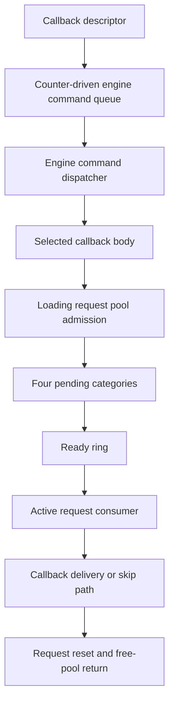

# Engine commands and downstream request lifecycle

This guide connects the recovered command and request paths relevant to a future
mod-command API. It describes one concrete callback caller and a shared downstream
loading-request mechanism. The engine command queue and loading request owner
are distinct objects. It is not a general safe-mutation API, a complete scheduler,
or evidence of original-engine equivalence. All checks described here are static
analysis or original-instruction emulation with labeled adapters, not live game
validation of these request paths.

## Connected path



The selected callback body supplies a second callback and context to the downstream
request. Successful callback delivery can release and free that context. Other
paths skip it. The paths' local connections are established, but a single complete
concurrent execution from the initial producer through final cleanup has not been
validated. Request preparation, opaque handlers, construction, cancellation and
shutdown remain explicit boundaries.

| Stage | Runnable reconstruction | Evidence and limitation |
| --- | --- | --- |
| Initial publication | `engine.callback_commands` | Full initial ring can drop a descriptor while increasing dispatch budget, leading to cached callback repetition |
| Engine command execution | `engine.command_executor`, `engine.command_drain` | Multiple entry paths; execution byte is not a recursion-safe drain indicator; some queues have quotas/time budgets |
| Selected caller follow-up | `engine.command_related_selection`, `engine.command_related_handler` | Related-record updates can precede failed downstream admission; they are not a callback completion wait |
| Request admission | `admit_pooled_request` in `engine.command_related_handler` | Obtaining a work record and returning from initializer/publisher does not prove eventual delivery |
| Pending/ready transfer | `engine.request_pending` | Four-category scan; resource preparation ends a pass; counters may advance without insertion |
| Active processing | `engine.request_consumer` | Callback codes 0/1/2 and multiple skip paths; active clears before recycle; signal also occurs without callback delivery |
| Selected context cleanup | `engine.request_context_cleanup` | Releases references and frees the supplied context on this callback's normal path; not universal cancellation cleanup |
| Record reuse | `engine.request_recycling` | Clears callback/context fields; no direct context free; free-ring accounting can diverge under supplied capacity pressure |

These module names and Python interfaces are our design. Native fields, routines
and verification receipts are documented in the linked detailed sections below.

## Loading owner and execution route

A static ownership audit now connects the downstream request owner to the named
`Loading Thread`. This is stronger than guessing from neighboring strings:

- Initialization allocates an object of size `0x338`, calls its constructor, stores
  it in the downstream singleton, and passes the name `Loading Thread` to thread
  setup with value 3.
- The constructor installs the vtable whose slot `+8` is the thread wrapper and
  whose slot `+0x10` is the run method. Nearby profiling labels identify
  `::Engine::Loading::LoadingThread::Init` and `ThreadRun`.
- The wrapper writes the object's thread classification into TLS and invokes
  slot `+0x10`, between the `+0x18` and `+0x20` virtual hooks.
- The run method directly invokes the same request consumer already reconstructed
  here. Thus the downstream callback has an established loading-thread route;
  it is not automatically a physics-phase callback.

Readable run-method pseudocode, omitting profiling and TLS setup:

```text
configure_thread_service(1)
while not owner.stop:
    old = atomic_fetch_add_i32(owner.wake_counter, -1)
    # Native CMP/JNS: test the sign of wrapped (old - 1), not signed old < 1.
    if sign_bit(wrap_i32(old - 1)):
        wait_service(owner.wake_event)
    auxiliary_service(owner)
    prepare_requests(owner)
    consume_requests(owner)
    global_followup_service()

if owner.active_request:
    lock(owner.request_lock)
    request = owner.active_request
    owner.active_request = null
    recycle_request(owner, request)
    unlock(owner.request_lock)

lock(owner.shutdown_registry_lock)
for index in reversed(range(initial_shutdown_callback_count)):
    # Registry base is reloaded before each indirect call.
    call(owner.shutdown_registry[index].callback)
unlock(owner.shutdown_registry_lock)
```

The outer loop does not recheck stop immediately after its wait. The consumer has
its own stop gate. The shutdown active-record path recycles without directly
calling the selected request callback. This reinforces the distinction between
record retirement and context cleanup. Shutdown callback ownership, registry
mutation and wait-service semantics are not yet reconstructed.

Evidence anchors for this build: initializer `0x11a2060`, constructor
`0x1188980`, vtable `0x28f1608`, wrapper `0x11e98f0`, run method `0x11ba990`,
consumer `0x1199a20`. These are research identifiers, not portable API constants.
The [static audit receipt](../../native/snow_host/loading_request_owner_validation.json)
records fresh-image span hashes and direct calls. This is not a live thread-ID
capture, emulated run-loop validation, or proof of exclusive thread affinity.

For mod integration, retain the engine command dispatcher as a separate candidate
execution boundary. Qualify its thread and held locks directly. Use this loading
path for resource-lifecycle research; do not route generic player mutations through
it solely because it can deliver a callback.

## What a mod receipt must distinguish

An API must separately report or qualify:

1. Whether the command descriptor actually entered its first queue.
2. Whether dispatch occurred, including repeated-delivery handling.
3. Whether a downstream work record was obtained and published into a pending ring.
4. Whether that request reached ready and active processing.
5. Whether its callback ran or a skip/alternate path occurred.
6. Who still owns the context and whether cleanup completed.
7. Whether the pooled record was reset and returned for reuse.

An event signal, zero execution byte, counter value or recycled pointer proves
none of this sequence by itself. Native work addresses need a generation or other
independently retained identity. Context and callback code must remain valid until
their documented ownership ends. No broad mutation permission follows from being
inside a callback; its thread, held locks and conflicting subsystem work still
need qualification.

## Native observation callback preparation

`native/snow_host/snow_command_observation.h` and `.c` provide an authored,
read-only kind-3 descriptor. Initialize one stable observation owner and caller-
owned record buffer, then retain them and the code for every possible delivery.
The descriptor source itself may be copied. This module does not publish into a
native queue or install a hook. Admission is still a separate unresolved contract.

The invoker records caller return address, thread provider value, entry/exit ticks,
receiver and descriptor-storage identity through `snow_delegate_trace`. The result
field is our supplied request ID, not an engine operation result. Multiple records
with the same ID are intentional: native queue behavior can repeat a cached
callback. Recording exhaustion increments a drop counter; it does not block the
callback. Close stops new recording, while retained late invocations still return.
Drained permits reading records; it does not permit freeing callback storage or
unloading code. Exceptions and nonlocal exits are outside the normal-return model.

The [compiled observer receipt](../../native/snow_host/command_observation_validation.json)
compares the original dispatcher and lock getter with our compiled Windows x64
observer in emulation. Twelve cases cover all four context tags and capacities
0/1/3, four supplied deliveries followed by one after close. The descriptor source
is overwritten after copying. Recorded caller RVA matches the kind-3 return site
`0x662b34`; record-storage identity is the dispatch copy, not the original source.
Lock services and thread/clock values are supplied. This establishes ABI plumbing,
not live thread identity, phase, exclusion, native admission or unload safety.

The [connected pipeline receipt](../../native/snow_host/command_observation_pipeline_validation.json)
extends this to 72 original-instruction cases through producer, descriptor copy,
preparation prefix, counted consumer, cleanup and dispatcher. Each submission has
its own retained observer and request ID. Queue capacities 1/2/4, submission counts
1 through 6 and all four context tags are supplied; 44 cases exercise overflow.
For capacity 2 and four submissions, the observed ID sequence is `1, 2, 2, 2`:
IDs 3 and 4 were not inserted in the constructed state, while ID 2 is dispatched
three times. The recorder uses the same consumer-local descriptor address for
distinct IDs. It must not use that address as request identity.

`engine.command_observation.summarize_deliveries` groups copied records by the
observer's authored request ID. It reports repeated delivery, observed threads,
unknown IDs, recording loss and shared temporary storage without emitting raw
addresses. Absent IDs remain `not_observed`, even with zero recording drops:
publication rejection, pending work or capture closure cannot be distinguished
from the capture alone. It does not infer a safe phase, admission receipt, drain
or unload permission. This authored interpreter is checked against all 72 cases.

```sh
python3 -m engine.examples.command_observation_probe
```

This runnable example uses synthetic records illustrating the validated pattern.
It does not contain or replay captured game memory.

The inspected lock wrappers load a pointer and transfer into `.upx0` code. Those
targets contain bytes in the analyzed image. Their section name and unusual
control flow do not by themselves identify a packer, virtualization scheme or
anti-debug mechanism. Native lock reentrancy remains unproved.

Run the portable C plumbing fixture through:

```sh
python3 -m unittest discover -s tests -p test_command_observation_native.py
```

For a future live pass, first qualify publication capacity under the queue lock,
retain owner/code for cached repetitions, and record actual thread ID and caller.
Keep capture bounded and perform no gameplay writes. The callback return site
identifies the dispatcher branch; it cannot distinguish frame versus transition
entry into the executor without additional enclosing provenance.

## Inspect the behavior without game files

```sh
python3 -m engine.examples.callback_command_probe
python3 -m engine.examples.command_budget_probe
python3 -m engine.examples.callback_followup_probe
python3 -m engine.examples.related_request_probe
python3 -m engine.examples.request_pending_probe
python3 -m engine.examples.request_lifecycle_probe
python3 -m engine.examples.request_recycling_probe
```

These examples use synthetic records and bound services. They make the local
rules inspectable; passing them does not validate the original game's concurrent
execution or authorize native injection/mutation.

## Evidence and next work

- [Initial callback producer and ABI](ANIMATION_CONTEXT_RETIREMENT.md#callback-command-producer-and-abi)
- [Post-submit follow-up](ANIMATION_CONTEXT_RETIREMENT.md#post-submit-follow-up-is-not-a-completion-receipt)
- [Downstream pool admission](ANIMATION_CONTEXT_RETIREMENT.md#related-handler-retention-and-downstream-request-admission)
- [Pending publication and ready transfer](ANIMATION_CONTEXT_RETIREMENT.md#pending-publication-and-ready-transfer)
- [Consumer gates](ANIMATION_CONTEXT_RETIREMENT.md#request-consumer-and-callback-gates)
- [Context cleanup](ANIMATION_CONTEXT_RETIREMENT.md#request-callback-binding-and-context-cleanup)
- [Acquisition and recycling](ANIMATION_CONTEXT_RETIREMENT.md#connected-acquisition-refusal-and-recycling)

Next test one pinned observation callback with explicit admission and completion
receipts at a verified engine phase. Avoid using arbitrary gameplay mutation as
the first proof. Scheduler stepping remains supporting instrumentation; the goal
is reusable lifecycle and subsystem contracts for broader modding. Continue loading
preparation, cancellation and receiver-creation research as a separate workstream.
