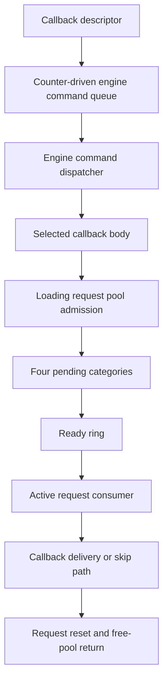

# Engine commands and downstream request lifecycle

This guide connects the recovered command and request paths relevant to a future
mod-command API. It describes one concrete callback caller and a shared downstream
loading-request mechanism. The engine command queue and loading request owner
are distinct objects. It is not a general safe-mutation API, a complete scheduler,
or evidence of original-engine equivalence. Most checks described here are static
analysis or original-instruction emulation with labeled adapters. The lock-target
identification below adds one read-only live observation; queued request execution
has not been validated live through this observer.

## Connected path



The selected callback body supplies a second callback and context to the downstream
request. Successful callback delivery can release and free that context. Other
paths skip it. The paths' local connections are established, but a single complete
concurrent execution from the initial producer through final cleanup has not been
validated. Request preparation, opaque handlers, construction, cancellation and
shutdown remain explicit boundaries.

| Stage | Runnable reconstruction | Evidence and limitation |
| --- | --- | --- |
| Initial publication | `engine.callback_commands` | Full initial ring can drop a descriptor while increasing dispatch budget, leading to cached callback repetition |
| Engine command execution | `engine.command_executor`, `engine.command_drain` | Multiple entry paths; execution byte is not a recursion-safe drain indicator; some queues have quotas/time budgets |
| Selected caller follow-up | `engine.command_related_selection`, `engine.command_related_handler` | Related-record updates can precede failed downstream admission; they are not a callback completion wait |
| Request admission | `admit_pooled_request` in `engine.command_related_handler` | Obtaining a work record and returning from initializer/publisher does not prove eventual delivery |
| Pending/ready transfer | `engine.request_pending` | Four-category scan; resource preparation ends a pass; counters may advance without insertion |
| Active processing | `engine.request_consumer` | Callback codes 0/1/2 and multiple skip paths; active clears before recycle; signal also occurs without callback delivery |
| Selected context cleanup | `engine.request_context_cleanup` | Releases references and frees the supplied context on this callback's normal path; not universal cancellation cleanup |
| Record reuse | `engine.request_recycling` | Clears callback/context fields; no direct context free; free-ring accounting can diverge under supplied capacity pressure |

These module names and Python interfaces are our design. Native fields, routines
and verification receipts are documented in the linked detailed sections below.

## Loading owner and execution route

A static ownership audit now connects the downstream request owner to the named
`Loading Thread`. This is stronger than guessing from neighboring strings:

- Initialization allocates an object of size `0x338`, calls its constructor, stores
  it in the downstream singleton, and passes the name `Loading Thread` to thread
  setup with value 3.
- The constructor installs the vtable whose slot `+8` is the thread wrapper and
  whose slot `+0x10` is the run method. Nearby profiling labels identify
  `::Engine::Loading::LoadingThread::Init` and `ThreadRun`.
- The wrapper writes the object's thread classification into TLS and invokes
  slot `+0x10`, between the `+0x18` and `+0x20` virtual hooks.
- The run method directly invokes the same request consumer already reconstructed
  here. Thus the downstream callback has an established loading-thread route;
  it is not automatically a physics-phase callback.

Readable run-method pseudocode, omitting profiling and TLS setup:

```text
configure_thread_service(1)
while not owner.stop:
    old = atomic_fetch_add_i32(owner.wake_counter, -1)
    # Native CMP/JNS: test the sign of wrapped (old - 1), not signed old < 1.
    if sign_bit(wrap_i32(old - 1)):
        wait_service(owner.wake_event)
    auxiliary_service(owner)
    prepare_requests(owner)
    consume_requests(owner)
    global_followup_service()

if owner.active_request:
    lock(owner.request_lock)
    request = owner.active_request
    owner.active_request = null
    recycle_request(owner, request)
    unlock(owner.request_lock)

lock(owner.shutdown_registry_lock)
for index in reversed(range(initial_shutdown_callback_count)):
    # Registry base is reloaded before each indirect call.
    call(owner.shutdown_registry[index].callback)
unlock(owner.shutdown_registry_lock)
```

The outer loop does not recheck stop immediately after its wait. The consumer has
its own stop gate. The shutdown active-record path recycles without directly
calling the selected request callback. This reinforces the distinction between
record retirement and context cleanup. Shutdown callback ownership, registry
mutation and wait-service semantics are not yet reconstructed.

Evidence anchors for this build: initializer `0x11a2060`, constructor
`0x1188980`, vtable `0x28f1608`, wrapper `0x11e98f0`, run method `0x11ba990`,
consumer `0x1199a20`. These are research identifiers, not portable API constants.
The [static audit receipt](../../native/snow_host/loading_request_owner_validation.json)
records fresh-image span hashes and direct calls. This is not a live thread-ID
capture, emulated run-loop validation, or proof of exclusive thread affinity.

For mod integration, retain the engine command dispatcher as a separate candidate
execution boundary. Qualify its thread and held locks directly. Use this loading
path for resource-lifecycle research; do not route generic player mutations through
it solely because it can deliver a callback.

## What a mod receipt must distinguish

An API must separately report or qualify:

1. Whether the command descriptor actually entered its first queue.
2. Whether dispatch occurred, including repeated-delivery handling.
3. Whether a downstream work record was obtained and published into a pending ring.
4. Whether that request reached ready and active processing.
5. Whether its callback ran or a skip/alternate path occurred.
6. Who still owns the context and whether cleanup completed.
7. Whether the pooled record was reset and returned for reuse.

An event signal, zero execution byte, counter value or recycled pointer proves
none of this sequence by itself. Native work addresses need a generation or other
independently retained identity. Context and callback code must remain valid until
their documented ownership ends. No broad mutation permission follows from being
inside a callback; its thread, held locks and conflicting subsystem work still
need qualification.

## Native observation callback preparation

`native/snow_host/snow_command_observation.h` and `.c` provide an authored,
read-only kind-3 descriptor. Initialize one stable observation owner and caller-
owned record buffer, then retain them and the code for every possible delivery.
The descriptor source itself may be copied. This module does not publish into a
native queue or install a hook. Admission is still a separate unresolved contract.

The invoker records caller return address, thread provider value, entry/exit ticks,
receiver and descriptor-storage identity through `snow_delegate_trace`. The result
field is our supplied request ID, not an engine operation result. Multiple records
with the same ID are intentional: native queue behavior can repeat a cached
callback. Recording exhaustion increments a drop counter; it does not block the
callback. Close stops new recording, while retained late invocations still return.
Drained permits reading records; it does not permit freeing callback storage or
unloading code. Exceptions and nonlocal exits are outside the normal-return model.

The [compiled observer receipt](../../native/snow_host/command_observation_validation.json)
compares the original dispatcher and lock getter with our compiled Windows x64
observer in emulation. Twelve cases cover all four context tags and capacities
0/1/3, four supplied deliveries followed by one after close. The descriptor source
is overwritten after copying. Recorded caller RVA matches the kind-3 return site
`0x662b34`; record-storage identity is the dispatch copy, not the original source.
Lock services and thread/clock values are supplied. This establishes ABI plumbing,
not live thread identity, phase, exclusion, native admission or unload safety.

The [connected pipeline receipt](../../native/snow_host/command_observation_pipeline_validation.json)
extends this to 72 original-instruction cases through producer, descriptor copy,
preparation prefix, counted consumer, cleanup and dispatcher. Each submission has
its own retained observer and request ID. Queue capacities 1/2/4, submission counts
1 through 6 and all four context tags are supplied; 44 cases exercise overflow.
For capacity 2 and four submissions, the observed ID sequence is `1, 2, 2, 2`:
IDs 3 and 4 were not inserted in the constructed state, while ID 2 is dispatched
three times. The recorder uses the same consumer-local descriptor address for
distinct IDs. It must not use that address as request identity.

`engine.command_observation.summarize_deliveries` groups copied records by the
observer's authored request ID. It reports repeated delivery, observed threads,
unknown IDs, recording loss and shared temporary storage without emitting raw
addresses. Absent IDs remain `not_observed`, even with zero recording drops:
publication rejection, pending work or capture closure cannot be distinguished
from the capture alone. It does not infer a safe phase, admission receipt, drain
or unload permission. This authored interpreter is checked against all 72 cases.

```sh
python3 -m engine.examples.command_observation_probe
```

This runnable example uses synthetic records illustrating the validated pattern.
It does not contain or replay captured game memory.

The inspected lock wrappers load a pointer and transfer into `.upx0` code. Those
targets contain bytes in the analyzed image. Their section name and unusual
control flow do not by themselves identify a packer, virtualization scheme or
anti-debug mechanism. The later live target identification and emulated recursion checks below qualify
these specific helpers without proving general mutation safety.

Run the portable C plumbing fixture through:

```sh
python3 -m unittest discover -s tests -p test_command_observation_native.py
```

For a future live pass, first qualify publication capacity under the queue lock,
retain owner/code for cached repetitions, and record actual thread ID and caller.
Keep capture bounded and perform no gameplay writes. The callback return site
identifies the dispatcher branch; it cannot distinguish frame versus transition
entry into the executor without additional enclosing provenance.

## Encoded lock-wrapper targets

The two opaque helper paths can now be reduced to target-decoding thunks for the
inspected image. An initial bounded trace of the unchanged image reaches invalid
instruction-fetch targets after 54 and 64 instructions. Each path performs one
image-data read from an encoded target slot. This failure is a static-image result,
not a native game crash or evidence of an anti-debug response.

The recovered local behavior is:

```text
enter_helper(wrapper):
    argument = read_u64(wrapper)
    encoded = read_u64(image_base + 0x3d9bc2d)
    target = (encoded + 0x796e0b07) modulo 2^64
    tail_transfer(target, first_argument=argument)

leave_helper(wrapper):
    argument = read_u64(wrapper)
    encoded = read_u64(image_base + 0x3c7a1b2)
    target = (encoded + 0x7b907d10) modulo 2^64
    tail_transfer(target, first_argument=argument)
```

The [original-instruction receipt](../../native/snow_host/lock_thunk_validation.json)
covers 96 cases, 48 per helper, with eight supplied target addresses, varying
pointees, randomized general-purpose registers and six flag patterns. At the
synthetic target, the first argument, original return address, stack pointer,
general-purpose nonvolatile registers and flags match expectations. A returning
stub reaches the original caller. All visited instruction spans are hashed.
Target slots are deliberately replaced in the emulator; this is not live import
resolution. SIMD state and alternate image bases are not tested.

`engine.lock_target_observation.decode_target` implements the recovered modular
addition and is checked against these cases. `observe_lock_targets` reads both
slots twice using a supplied reader, at most four reads and 32 bytes. It refuses
short or failed reads and withholds targets if the samples differ. Equal samples
are not atomic or proof of lifetime. The returned addresses are session-private;
do not publish them as portable constants or raw memory captures.

This reduces the next live check to reading those slots, decoding the targets,
and resolving them against the process's current modules and exports. A lower
user-address-range target is not proof of executable memory or API identity.
The slot initialization/writer remains open. The live target resolution and
recursion checks below supersede the earlier identity uncertainty for this one
Wine build/session. Names alone would not have been sufficient.

## Live lock identity and guarded publication

A [read-only live session](../../native/snow_host/lock_target_live_validation.json)
resolved the decoded targets to Wine `ntdll.dll` exports:

| Helper | Exact export | Observed module RVA |
| --- | --- | --- |
| Enter | `RtlEnterCriticalSection` | `0x21fe0` |
| Leave | `RtlLeaveCriticalSection` | `0x2b540` |

The reader checked PID and creation identity on each request. Both decoded slots
were stable before and after module resolution; each target's first 32 bytes
matched its on-disk module implementation. This is one session at scheduler
readiness, not a full in-memory module hash or a live callback/submission test.
The probe did not call the targets or send movement input. The bottle stopped;
saves/settings were restored and the original input DLL was verified.

Windows critical sections permit repeated acquisition by the owning thread with
one release required per acquisition. See [Microsoft's contract](https://learn.microsoft.com/en-us/windows/win32/api/synchapi/nf-synchapi-entercriticalsection).
For the observed Wine module specifically, the original game thunks composed with
its actual lock implementation also pass [emulated recursion checks](../../native/snow_host/recursive_lock_validation.json)
at depths 1/2/3/8. The fixture supplies a same-thread TEB and an initialized
spin-zero critical section. Lock count, recursion count and owner balance on
release. Contention, wait/wake, destruction and exception paths are excluded.

An initial **authored admission candidate** was tested around the original
producer in 18 serial instruction cases. It is now superseded: keeping its outer
lock through producer cleanup changes the original lock order, as explained below.
This historical pseudocode is not the current adapter:

```text
# Preconditions: verified live build, ordinary producer route, retained manager,
# valid initialized lock/array, retained descriptor context and callback module.
acquire(manager.queue_lock)
if manager.queue_count >= manager.queue_capacity:
    release(manager.queue_lock)
    return not_submitted_full     # Do not call the native producer.
call_original_producer(manager, descriptor, alternate_route=false)
# Producer recursively acquires/releases this same lock.
release(manager.queue_lock)
return submitted                 # Not a callback completion receipt.
```

Capacities 1/2/4 and 1 through 6 attempted submissions leave queue count and
pending budget equal to the number admitted. This avoids the tested full-ring
budget increment for **this submitting adapter** by refusing before the native
call. It does not repair other producers that submit when full, establish exactly-
once delivery, or prevent earlier counter/queue divergence. A concurrent consumer
and lock destruction were not exercised. Counter transfers and all competing
producers must still be audited before promising reliable publication.

Do not acquire the separate dispatch lock as part of this guard. Lock ordering,
manager lifetime, module pinning, and the thread/phase where callbacks execute
remain separate requirements. The next native experiment can use this qualified
recursive-lock identity to prepare a bounded, observation-only submission adapter;
it must not infer permission to mutate gameplay or unload after one callback.

## Native guarded-admission adapter

`native/snow_host/snow_command_admission.h` and `.c` now use the recovered record
copy and cleanup helpers, rather than calling the complete producer inside an
outer queue lock. The binding supplies retained manager storage, verified
enter/leave/copy/cleanup functions, the build's default holder and a bounded
identity check. The check runs under the queue lock; it cannot establish that the
lock storage was safe to acquire. Lifetime retention is a precondition.

The initial nested-producer adapter changed lock ordering. In the original
producer, temporary cleanup follows queue unlock. Its two default-holder decrements
can reach a zero low-24-bit count and call the resource release helper. That helper
acquires a separate manager lock **before** checking the holder's suppression bit
26. A suppressed destructor therefore does not mean no additional lock is acquired.
The initial high-count fixtures missed this boundary. This establishes a changed
lock order, not proof of an actual observed deadlock.

The corrected authored adapter follows this structure:

```text
copy descriptor into caller-owned temporary value
acquire(queue_lock)
validate binding and ring fields
if invalid or full:
    release(queue_lock)
    return refusal
construct temporary kind-3 record with two default-holder references
copy_record_into_ring(destination, temporary)  # original helper; retains holders
advance queue count/write cursor
atomic_increment(deferred_budget)
release(queue_lock)
cleanup_temporary_record(temporary)           # original helper; may acquire resource lock
return submitted
```

The 104-byte temporary record has kind 3, default holders at +8/+16, the descriptor
at +24 and no associated reference at +96. Unused fields are authored zeroes. No
source context or callback-module lifetime is retained by this layout. The ring
lock covers publication; it is released before temporary cleanup. Full refusal
makes no temporary-holder release or budget change. That refusal behavior is an
authored correction, not the full-ring behavior of the original producer.

Statuses distinguish `SUBMITTED`, `FULL`, `INVALID_BINDING`, `STALE_BINDING` and
`INVALID_RING`. `SUBMITTED` reports publication and normal return from temporary
cleanup, not callback delivery. Exceptions/nonlocal exits are not caught. Binding
and descriptor inputs must remain immutable during the call; callback context and
code must survive every possible later delivery.

The older [nested-producer receipt](../../native/snow_host/command_admission_validation.json)
is preserved as limited historical evidence. The current
[cleanup-order receipt](../../native/snow_host/command_admission_cleanup_validation.json)
executes the compiled Windows adapter with original copy/cleanup/release helpers,
game lock thunks and observed Wine critical-section routines. All 90 supplied cases
match successful original-producer publication in meaningful kind-3 record fields,
queue/cursor/budget fields, holder counts and final lock state. The fixture compares
capacities 1/2/4, 1 through 6 submissions, three synthetic holder-count boundary states with bit 26
set and two actual words observed in the live interval described below. Across adapter and reference paths, 140 resource-release helper calls occur
with the queue lock released. Payload destruction, concurrency and exceptions
remain excluded; unspecified record bytes are not claimed equivalent.

```sh
python3 -m unittest discover -s tests -p test_command_admission_native.py
```

This adapter is not installed live. A bounded direct-reference scan of the command
singleton found readers but no direct writer. That does not establish permanent
storage or exclude indirect writers/destructors. Manager teardown, competing
producers, counter transfers and callback phase remain live-integration gates.

## Connected admission-to-observation validation

The [connected compiled pipeline receipt](../../native/snow_host/command_admission_delivery_validation.json)
joins the current C admission adapter and C observer through original preparation,
counted consumption, dispatch and record cleanup. The lock helpers run through the
observed Wine critical-section implementation with a supplied TEB/thread identity.

Across 72 serial cases (capacities 1/2/4, 1 through 6 attempted submissions and all
four context tag values), each admitted request ID produces one captured callback;
refused IDs produce none. Overwriting the descriptor source after publication does
not change delivery. A second zero-budget drain creates no new records. Every
record has the expected kind-3 dispatcher return site and receiver. Callback clock
and thread probes execute with the dispatch lock held and the queue lock released.
All queue/resource/dispatch lock states return to their initial unlocked state.

This is an end-to-end **local instruction composition**, not live callback delivery
or a universal exactly-once contract. The fixture retains all owners/code, starts
with empty queues and includes no competing producers or interleaved counter
transfers. Preparation stops after its empty participant traversal. Clock, thread
provider and binding validator are supplied; actual engine phase is not identified.

The integrated consumer additionally reaches the resource-release helper with the
queue lock held in 144 supplied boundary occurrences. Earlier producer-only
fixtures did not exercise this path. Consequently:

- Releasing the producer's temporary record after unlocking preserves that
  producer's local order; it is not a global engine prohibition on nested locks.
- The old outer-producer wrapper changed a local order, but these results do not
  establish that it caused a deadlock or introduced a globally new lock edge.
- Native consumption requires a broader lock-order graph and lifetime analysis.

The manager ownership search also now includes nearby globals and leaf wrappers
missing from unwind metadata. A descriptor wrapper at `0x653620` merely remaps
arguments, reloads the singleton and tail-calls the producer. It provides no pin
or generation token. No manager writer/lifetime mechanism was established by
these bounded searches; absence from the search is not evidence of permanence.

## Live manager storage and queue state

A [read-only live interval](../../native/snow_host/command_manager_storage_live_validation.json)
contains 20 PID/creation-guarded samples while the host-reported engine step count
advances by 275. Manager, critical-section and array pointers and capacity remain
equal across those samples. Capacity is 3072; count, active and deferred budgets
stay zero. Read/write cursors stay equal and unchanged. No command or movement
input was submitted.

All three addresses belong to `MEM_PRIVATE`, `PAGE_READWRITE` regions: 64 KiB for
the manager and lock, 320 KiB for the array. These are containing-region sizes,
not object sizes or proof of a particular allocator. Executable-module pinning
would not pin these allocations. Sampled stability does not close the ownership,
invalidation or destruction questions.

The shared default-holder word varies across seven observed values bounded by
`0x807fffe1` and `0x807fffff`, with bit 31 set and bit 26 clear. The observed
endpoints extend the original-instruction admission comparison to 90 cases; they
are fixture inputs, not immutable configuration. The portable C fixture also
checks final-slot wrap at capacity 3072 using full backing storage.

The session stopped normally; saves/settings were restored and the original DLL
verified. Private-allocation lifetime and callback phase remain open. An empty
queue during this interval does not by itself establish safe native submission.

## Command-manager initialization contract

Searching for the live capacity, 3072, identifies a constructor-shaped routine
at RVA `0x647650`. Its layout matches the observed manager across both budget
pairs, the primary ring, participant container, execution flag and auxiliary
buffers. This is a static layout attribution, not a captured native constructor
call or proof of singleton ownership.

The [constructor fixture](../../native/snow_host/command_constructor_validation.json)
executes the original constructor and ring-allocation helpers in five cases:
all allocations succeed, then each of four allocations independently returns
null. Lock initialization, allocator services, container initialization and empty
buffer cleanup are synthetic. Every case returns the receiver; this does not
establish that the native allocator returns null rather than throwing or exiting.

Recovered initialization, with descriptive names chosen for this reconstruction:

```text
initialize(manager):
    initialize_lock_wrapper(manager + 0x00)
    zero_ring_header(manager + 0x30)       // pointer and four u32 fields
    allocate_primary_ring(manager + 0x30, 3072, record_bytes=104)
    manager.active = 0                   // +0x50
    manager.deferred = 0                 // +0x54

    initialize_lock_wrapper(manager + 0x58)
    zero_ring_header(manager + 0x88)
    allocate_secondary_ring(manager + 0x88, 4, record_bytes=16)
    manager.secondary_active = 0         // +0xa8
    manager.secondary_deferred = 0       // +0xac
    initialize_container(manager + 0xb0, 0)
    manager.executing = false            // +0xbc

    initialize_lock_wrapper(manager + 0xc0)
    initialize_container(manager + 0xf0, 0)
    initialize_empty_buffer(manager + 0x100, ownership_byte=1)
    initialize_lock_wrapper(manager + 0x120)
    initialize_container(manager + 0x150, 0)
    initialize_empty_buffer(manager + 0x160, ownership_byte=1)
    allocate_buffer(manager + 0x100, 128 * 104)
    allocate_buffer(manager + 0x160, 128 * 104)
    return manager
```

The primary ring helper at `0x659170` requests `capacity * 104` bytes, writes
its returned pointer, and sets capacity to the requested value on success or zero
on null. Successful allocation sets the byte at ring-header `+0x18` to one.
The four allocation sizes are 319,488, 64, 13,312 and 13,312 bytes. The primary
request fits the previously observed 327,680-byte containing region; region
size still does not identify the allocator or an exact allocation boundary.

The lock-wrapper initializer's visible prefix stores `wrapper + 8` into the
wrapper's first pointer before calling an encoded target. This suggests inline
critical-section storage, but the target's initialization semantics were not
executed by this fixture. Do not infer a separate lock allocation merely from a
memory-region report.

A bounded direct-relative-call search found no caller of this constructor in the
inspected image. Indirect calls, transformed call paths and startup-only code
remain candidates. The next ownership search can now start from this constructor
and its buffer teardown counterparts, rather than only singleton readers.
No lifetime pin or safe native publication point follows from initialization alone.

## Inline lock storage and initializer target

Re-examining the existing 20-sample live capture establishes `lock == manager + 8`
in every sample. This agrees with the initializer's visible pointer assignment;
it is not a new live session or evidence that the allocation cannot disappear.

The [initializer instruction fixture](../../native/snow_host/lock_initializer_validation.json)
now traces and validates the encoded call in 48 supplied-target cases:

```text
initialize_lock_wrapper(wrapper):
    wrapper.pointer = wrapper + 8
    target = u64(read_u64(image_base + 0x37ede4a) + 0x5a0d734c)
    target(wrapper + 8, 4096, 0x02000000)
    return wrapper
```

The target transfer returns to RVA `0x1c367c1`, bypassing the intervening `hlt`
byte in this inspected path. All tested nonvolatile integer registers survive.
Three supplied target addresses, four register seeds and four initial flag words
exercise the thunk. Synthetic callees return success; SIMD, relocation and native
initialization semantics remain untested. The unchanged image's target slot does
not itself resolve to a valid callable destination. Do not name a Windows API
from its apparent argument shape alone.

`observe_lock_targets(..., include_initializer=True)` now reads all three slots
twice, at most six reads / 48 bytes. The default remains enter/leave only, four
reads / 32 bytes. The subsequent live observation below resolves the initialization target
against loaded modules and exports without calling it.

No absolute constructor function pointer was found in the inspected mapped
image. The bounded relative-displacement search within unwind-described code
found singleton readers but no constructor reference or singleton writer. These
search exclusions do not establish permanence or rule out indirect/transformed
startup paths. Manager ownership and shutdown remain open.

## Live initialization API identity

A [read-only Wine session](../../native/snow_host/lock_initializer_live_validation.json)
resolves the new initializer target exactly to `kernel32.dll!InitializeCriticalSectionEx`,
module RVA `0xe708`. The first 32 target bytes match the installed module file.
Enter and leave again resolve to the previously observed `ntdll` critical-section
exports. All three slots remain equal across the before/after observations.

Combined with the instruction fixture, the recovered call is:

```text
wrapper.pointer = wrapper + 8
InitializeCriticalSectionEx(wrapper + 8, 4096, 0x02000000)
return wrapper
```

The inspected MinGW-w64 14.0.0 `winnt.h` names `0x02000000` as
`RTL_CRITICAL_SECTION_FLAG_DYNAMIC_SPIN`. That header label does not prove how
this Wine implementation handles the flag or how many spins occur in practice.
The wrapper does not test the API return value on the inspected normal-return
path; the fixture supplies success and does not model initialization failure.

The probe made 15 guarded reads totaling 192 bytes across encoded slots and code
prefixes. It did not call these functions, send movement input or submit commands.
The session stopped normally with saves/settings restored and the original DLL
verified. This establishes API identity in the observed Wine build, not safe
initialization or deletion of a live manager lock. Ownership, publication,
destruction and synchronization with plugin submission remain open.

## Lock deletion and event-wrapper identities

A [second bounded target-resolution session](../../native/snow_host/lock_lifecycle_live_validation.json)
distinguishes five pointer wrappers that otherwise have similar encoded-call
shapes. The [instruction fixture](../../native/snow_host/lock_lifecycle_thunk_validation.json)
validates 240 supplied-target cases: 48 per wrapper, preserving the caller stack,
flags and nonvolatile integer registers, with `RCX = read_pointer(wrapper)` at
the target. SIMD and ASLR remain excluded.

| Wrapper RVA | Encoded slot RVA | Addend, modulo 2^64 | Observed exported target |
| --- | --- | --- | --- |
| `0x115d480` | `0x3f6fab0` | `0x2b6a317d` | `kernel32!FlushFileBuffers` |
| `0x1221400` | `0x35db73b` | `0x68915110` | `kernel32!CloseHandle` |
| `0x1221410` | `0x3ee2f8e` | `0x1a156938` | `kernel32!ResetEvent` |
| `0x1c370b0` | `0x3f4320b` | `0x0459521e` | `ntdll!RtlDeleteCriticalSection` |
| `0x1c3b570` | `0x3dc7c29` | `0x7ef2492e` | `kernel32!SetEvent` |

Each live target resolves exactly to the indicated export and has a 32-byte code
prefix matching its installed module file. Seven slots, including the existing
enter/leave controls, remain stable before and after resolution. The probe makes
35 guarded reads totaling 448 bytes, calls none of these APIs, and submits no
commands. Cleanup verifies game exit, saves/settings restoration and the original
DLL. Target names do not prove a manager-specific invocation or synchronization
policy.

A direct-relative-call scan finds 479 instruction-boundary-checked calls to the
delete wrapper within unwind-described functions. No manager destructor has been
identified from these calls. A caller at `0x72e0e0` deletes a lock at receiver
`+0x120`, but also releases containers at `+0x1e8` and `+0x1c8` and uses a `0x210`
size in a conditional delete path. Matching a single offset is insufficient to
assign this function to the command manager.

A separate sequence at `0x662570` can now be described more precisely:

```text
call virtual_slot_0x10(global_A)
owner = global_B
owner.byte_0 = 1
owner.byte_0x46 = 0
ResetEvent(read_pointer(owner + 0x48))
if owner.byte_0x58 == 0:
    unresolved_helper(owner)
tail_call unresolved_helper_2(owner + 0x60)
```

This initial description is superseded by the cross-reference below: the
conditional and final helpers already have graph-setup and job-submission
identities in the delegate research. The initial virtual service remains opaque.

## Root submission entry sequence

Cross-referencing [the delegate lifecycle research](SCHEDULER_DELEGATES.md#submission-enables-the-teardown-wait)
identifies `0x11e2ca0` as job submission, including its usage/wait-flag store.
The conditional `0x6968e0` routine installs callable bindings and graph edges,
as distinguished from construction in the same guide. Thus `0x662570` is an
outer root-submission sequence, not a thread wait or teardown routine.

```text
submit_root_sequence():
    call virtual_slot_0x10(global_A)
    owner = read(global_B)                 // after the initial service
    owner.byte_0 = 1
    owner.byte_0x46 = 0
    ResetEvent(read_pointer(owner + 0x48)) // return value is ignored
    if owner.byte_0x58 == 0:               // sampled after ResetEvent
        prepare_graph_and_bindings(owner)
    return submit_job(owner + 0x60)
```

The [independent model](../../engine/frame_submission.py) supplies the unresolved
service bodies explicitly. It does not duplicate or replace the existing job
request reducers. A [48-case original-instruction comparison](../../native/snow_host/root_submission_validation.json)
validates the outer sequence and original encoded ResetEvent thunk, with graph,
submission and API bodies intercepted. Cases vary initial and post-event gate,
API return, submission return, and a changed global owner after the first call.
The native sequence and model agree on service order, flags and returned value.
Three public tests additionally cover nonzero byte gates and supplied-service
failure boundaries; exception behavior is authored, not native evidence.

This connects event reset, optional graph setup and root submission. It does not
establish when the event is signaled, who waits on it, the outer caller's exact
frame phase, or the root owner's lifetime. It does not close the separate command
manager's publication/destruction gap.

A direct-call search yields a caller at `0xd2c63`. Its immediate sequence calls
a receiver's virtual slot `+0x10`, submits through this entry, calls the same
receiver's slot `+8`, then calls `0x6a5230`. This supplies a next caller/phase
lead; those surrounding services and the outer function are not validated by
the 48-case fixture.

## Root cycle completion and event wait

The caller following root submission reaches `0x6a5230`. It reads the same owner
singleton, passes the event holder at `owner + 0x48` to wrapper `0x1c3d410`, then
clears owner byte zero after that call returns. The wrapper loads the handle and
sets timeout `0xffffffff`. A [read-only live check](../../native/snow_host/root_event_wait_live_validation.json)
resolves its encoded target to `kernel32!WaitForSingleObject`, module RVA
`0x10568`, with matching code prefix. The target is decoded as
`u64(read_u64(image_base + 0x3ee3be4) + 0x7ac81225)`.

The graph setup references callback body `0x662440`, copying its descriptor into
owner `+0x4f60`, within the embedded job beginning at `+0x4dc8`. That callback's
normal-return path is:

```text
finish_root_cycle(owner):
    locked_memory_barrier()
    context = current_context()
    if context != null: service_context(context)
    global_service.virtual_slot_8()
    service_other_global()
    prepare_next_cycle(owner)
    if owner.byte_0x46 == 0:
        return submit_job(owner + 0x60)
    return SetEvent(read_pointer(owner + 0x48))

wait_root_event():
    owner = read(owner_singleton)
    result = WaitForSingleObject(read_pointer(owner + 0x48), 0xffffffff)
    owner.byte_0 = 0
    return result
```

`prepare_next_cycle` names the still-partially-decoded `0x658660` service, which
updates job relationships and samples another global flag. Its full effects are
not replaced by an invented completion test. The stop-byte test follows all
services, and the wait clears the originally captured owner's byte even if the
global pointer changes during the call. There is no check of the wait result in
this wrapper. Native wait failure has not been observed.

The [independent implementation](../../engine/frame_submission.py) exposes these
sequences with explicit service adapters. An [original-instruction fixture](../../native/snow_host/root_cycle_validation.json)
checks 18 callback cases and four wait cases, including optional context service,
zero/nonzero post-service stop bytes, supplied returns and owner-global changes.
The original signal and wait thunks execute against synthetic API targets;
service and job bodies are intercepted. The original root-submission comparison
still passes all 48 cases with this module revision.

This closes a local submit/resubmit/signal/wait connection. It does not fully explain
the stop request, prove every dependency completed before the callback,
qualify the graph's phase relative to physics, or establish manager lifetime and
plugin unload safety. The wait wrapper has no job-pumping loop, but neither that
fact nor the resolved API rules out worker execution elsewhere.

A subsequent bounded writer scan finds `0x6652b8` storing one to `+0x46`
after loading the same owner singleton. Its containing routine `0x665250` calls
several services first, sets a separate global byte, and checks the owner pointer
for null before storing. This establishes a static writer lead; its upstream
trigger and preceding service effects are not validated by the cycle fixture.
Another write at `0x655e0d` uses a different, unqualified receiver and is not
assigned to this owner merely because the offset matches.

The live target check used 15 guarded reads / 192 bytes and did not wait, signal,
submit work or send movement input itself. The game stopped normally and cleanup
verified saves/settings restoration and the original DLL.

## Root stop request and persistent flag

The writer at `0x665250` is now reconstructed as a stop-request sequence, with
its preceding service meanings left explicit. The [12-case original-instruction
comparison](../../native/snow_host/root_stop_validation.json) matches the
[independent model](../../engine/root_stop.py) for absent/present/changed owners,
optional receiver presence and initially clear/set global request flags.

```text
request_root_stop():
    service_A(its_global_receiver, 0x40, 0x0f, true)
    service_B(reload_its_global_receiver())
    if provider.virtual_slot_0x220() != null:
        receiver = reload_provider().virtual_slot_0x220()
        receiver.virtual_slot_0()
    owner = read(owner_singleton)
    global_request_byte = 1
    if owner != null:
        owner.byte_0x46 = 1
```

The second receiver lookup is not replaced with the first result. Native code
dereferences that second result without a further null test. This is an ordering
and lifetime requirement, not a safe getter API. Services A and B acquire locks
internally in their inspected prefixes, but their complete effects and subsystem
semantics are not recovered here; the fixture intercepts them.

The getter at `0x674fa0` returns the same global request byte (`0x312f32c`) that
this routine sets. Caller `0xd2900` runs three preceding services, tests the getter's
low byte, then tail-calls the request routine when nonzero. Thus the request byte
can drive repeated requests until another writer clears it; this is not an
ordinary completion pulse. A second caller at `0xd13d9` is in input-dispatch code.
Its exact control mapping and eligibility gates remain unresolved.

The public composed test requests stop, verifies that no event has yet been
signaled, executes the existing cycle callback with services supplied, observes
signal instead of resubmission, then returns from a supplied wait and clears
owner byte zero. The global request byte remains set. This demonstrates the
reconstructed local sequence only: the original full graph, actual OS waiting,
stop-trigger eligibility, request reset and owner destruction are not executed.

The known sequence is therefore:

```text
request: run prerequisite services; set global request; set owner stop byte
later callback: run cycle services; observe stop byte; signal owner event
waiter returns: clear owner active byte, without testing wait result
```

This removes the unknown local stop-byte writer. It does not establish a general
mod shutdown API or show that all cached callbacks, other queues and workers are
quiescent when this event becomes signaled.

## Application-close evidence and handshake scope

The stop connection above must not be mistaken for a reusable per-frame barrier.
New window-message evidence ties the persistent request byte to application-close
handling. The [original-instruction route fixture](../../native/snow_host/root_close_route_validation.json)
executes 160 message-table cases, 16 close-gate cases and three complete passive
setter cases. It does not close a live window or execute the full close services.

The dispatch prefix at `0xccf14` selects the branch at `0xccfa4` only for message
`0x10` among values 1 through `0xa0`. The installed MinGW-w64 `winuser.h` defines
that value as `WM_CLOSE`. The branch's recovered gates are:

```text
on_close_branch(cookie):
    if global_gate_u32 != 0:
        return 0
    if cookie != 0xc0ffee:
        delegate_close_service(window)
        return 0
    # Special close sequence follows. It calls other unresolved services,
    # writes additional state, then calls the passive request setter.

set_global_stop_request():
    global_request_byte = 1
```

The cookie is compared with the value captured from the incoming `R8` argument;
it is not a newly proposed public API or proof that ordinary user close directly
runs the special sequence. That sequence's static call at `0xccffb` reaches the
complete passive setter `0x68c620`. Unlike `request_root_stop`, this setter only
stores the global byte: no owner dereference, job submission or event signal.

Two message-processing-shaped routines at `0xcd690` and `0x67dca0` compare a
stack-record field at offset eight with `0x12` (`WM_QUIT` in the same header).
The former calls the passive setter; the latter writes the request byte directly.
Their encoded message API targets have not been resolved here, so this is static
message-layout evidence, not a live message-pump proof. The second routine is
called by `0x69d6a0`; that same caller subsequently invokes command preparation
`0x67ced0` on the command-manager singleton. This connects message processing
and command preparation in one inspected caller without proving its entire phase.

A bounded scan for common direct RIP-relative byte stores finds the existing
three set-to-one sites and no clear-to-zero site for the global request byte.
This does not exclude register-relative writes, bulk initialization, transformed
code or another lifecycle. The separate owner stop byte is explicitly cleared by
root submission, but that does not establish reset of this global request.

The strongest supported interpretation is an application-stop handshake with
root resubmission until stop is requested. A reusable restart, one-physics-step
barrier, full engine shutdown and mod unload boundary remain unproved. The models
retain descriptive root/cycle names and must not be used to imply those broader
semantics.

## Buffer disposal is not callback delivery

The constructor's auxiliary-buffer cleanup leads to clear routine `0x658470`
and release routine `0x66b6a0`. These establish local buffer behavior, not the
manager's destructor: the bounded relative-call/jump search found the constructor
calling release, and release calling clear, but no manager shutdown caller.

The [original-instruction disposal fixture](../../native/snow_host/command_disposal_validation.json)
checks 200 valid ring states at capacities 1, 2, 4 and 8, including 70 wrapped
cases. It exercises every read cursor and occupancy from empty through full,
with both owned and borrowed backing storage. Allocator lookup/free are synthetic;
record cleanup executes original instructions with null associated references
and holder counts above their destruction threshold.

Recovered equivalent pseudocode for valid ring states:

```text
clear_records(ring):
    first_count = min(ring.count, ring.capacity - ring.read)
    for index in [ring.read, ring.read + first_count):
        cleanup_record(ring.array[index])
    for index in [0, ring.count - first_count):
        cleanup_record(ring.array[index])
    ring.write = 0
    ring.read = 0
    ring.count = 0

release_buffer(ring):
    clear_records(ring)
    if ring.owns_storage and ring.array != null:
        allocation_info = allocator_lookup(ring.array)
        allocator_free(ring.array, allocation_info)
    ring.owns_storage = true
    ring.array = null
    ring.capacity = 0
```

The second segment in clear is inlined cleanup rather than another call to the
cleanup helper. Both segments clear the invoker and release the two holder
references. Non-null associated objects and final-reference resource destruction
have additional paths excluded from this fixture. Unoccupied slots are untouched.
No descriptor callback is invoked; clearing is not draining by execution.

The independent [disposal module](../../engine/command_disposal.py) implements
this valid-ring contract with caller-supplied record cleanup and allocator
services. It matches cleaned-slot effects, allocation events and final headers
in all 200 original-instruction fixture cases. Seven public tests additionally
check wrap order, borrowed storage, empty release, validation and supplied-service
failures. Exception behavior is exposed as partial progress without rollback;
native exception handling is not established. This module is not wired into a
native shutdown hook and does not manufacture cancellation receipts.

Consequences for an eventual mod API:

- Admission and completion must remain distinct receipts. Removing an accepted
  record through disposal does not constitute callback completion.
- These helpers do not supply a plugin-context destruction callback. Do not free
  callback state or unload plugin code merely because the queue appears empty.
- A future shutdown adapter needs the actual owner lifecycle, synchronization and
  explicit cancellation accounting. This local helper does not establish where
  that adapter may safely run or whether shutdown uses this helper at all.

## Combined native-code inspection probe

Run the actual authored C admission and observation components together, with a
synthetic dispatcher and synthetic lifetime/lock services:

```sh
python3 scripts/run_command_pipeline_probe.py
```

A native 64-bit C11 compiler is required (`--cc gcc` may be appropriate on
Windows with MinGW-w64). The script builds in a temporary directory, runs the
probe, prints JSON and removes its build output. On macOS it uses the selected
Xcode SDK unless `SDKROOT` is already supplied. It never loads a game, injects a
DLL or accesses a game installation.

The [probe source](../../native/snow_host/examples/command_pipeline_probe.c)
combines `snow_command_admit`, `snow_command_observation_init` and the delegate
recorder. It overwrites source descriptors after publication, then exercises:

| Request | Admission | Subsequent synthetic behavior |
| --- | --- | --- |
| 101 | Submitted | Two recorded invocations, one recorder overflow; a retained cached call still returns after recorder close |
| 102 | Submitted | Record disposed without invocation, so no callback observation |
| 103 | Full | No publication or callback observation |
| 104 | Stale binding | Binding guard refuses publication |

The report separates admission, observed deliveries and recorder loss. Empty
queue and drained recorder do not become unload guarantees. The fixed synthetic
disposal is known to this harness; it is not a native cancellation receipt inferred
from missing records. Likewise its repeated invocations are deliberately driven
by the harness, not a claim about how often the original scheduler delivers.

This is a public integration baseline for the compiled components already tested
against original instructions privately. It does not close the live publication,
manager lifetime or verified execution-phase requirements. The probe is a console
program, not a SnowMod plugin; do not place it in the host's plugins directory.

## Inspect the behavior without game files

```sh
python3 -m engine.examples.command_disposal_probe
python3 -m engine.examples.callback_command_probe
python3 -m engine.examples.command_budget_probe
python3 -m engine.examples.callback_followup_probe
python3 -m engine.examples.related_request_probe
python3 -m engine.examples.request_pending_probe
python3 -m engine.examples.request_lifecycle_probe
python3 -m engine.examples.request_recycling_probe
```

These examples use synthetic records and bound services. They make the local
rules inspectable; passing them does not validate the original game's concurrent
execution or authorize native injection/mutation.

## Evidence and next work

- [Initial callback producer and ABI](ANIMATION_CONTEXT_RETIREMENT.md#callback-command-producer-and-abi)
- [Post-submit follow-up](ANIMATION_CONTEXT_RETIREMENT.md#post-submit-follow-up-is-not-a-completion-receipt)
- [Downstream pool admission](ANIMATION_CONTEXT_RETIREMENT.md#related-handler-retention-and-downstream-request-admission)
- [Pending publication and ready transfer](ANIMATION_CONTEXT_RETIREMENT.md#pending-publication-and-ready-transfer)
- [Consumer gates](ANIMATION_CONTEXT_RETIREMENT.md#request-consumer-and-callback-gates)
- [Context cleanup](ANIMATION_CONTEXT_RETIREMENT.md#request-callback-binding-and-context-cleanup)
- [Acquisition and recycling](ANIMATION_CONTEXT_RETIREMENT.md#connected-acquisition-refusal-and-recycling)

Next test one pinned observation callback with explicit admission and completion
receipts at a verified engine phase. Avoid using arbitrary gameplay mutation as
the first proof. Scheduler stepping remains supporting instrumentation; the goal
is reusable lifecycle and subsystem contracts for broader modding. Continue loading
preparation, cancellation and receiver-creation research as a separate workstream.


## Command-to-phase correlation

`engine.command_phase.correlate_command_phases` is an authored diagnostic for
joining copied command-observer records to copied enclosing-phase records. It
implements no original scheduler policy and publishes no commands. The caller
must provide matching acquisition session IDs, clock IDs and clock frequency;
the function validates equality, not the truth of externally supplied provenance.
Do not combine captures from different launches even if their timestamps overlap.

For each command invocation, it retains the request ID and searches for phase
intervals that contain the entire invocation on the same observed thread.
Exactly one candidate is `unique_containment`; multiple candidates remain
`ambiguous_containment`; absence is `not_matched`. It does not choose the nearest
frame, erase repeated request IDs, or use another thread's overlapping interval.
Equal clock ticks can make adjacent phases ambiguous. Input phase indexes identify
records within this capture only, not persistent job identities. Drop counts from
both recorders remain visible; an unmatched command is not proof of execution
outside the phase, because missing records or capture-window differences may
explain it. Containment does not itself prove call ancestry or native phase.

The public `python3 scripts/run_command_pipeline_probe.py` now wraps synthetic
command dispatch in the actual authored C delegate recorder. Its output includes
command intervals, phase intervals and `phase_correlation`. Two retained command
records match two distinct enclosing phase records while preserving request 101.
The fixture alternates supplied synthetic thread IDs; it does not spawn two OS
threads. Four phase calls remain visible, including the command-recorder overflow
and the cached call after command-recorder close. These cases exercise the join
without treating absent command records as nonexecution.

The separate live engine-main capture establishes that the selected enclosing
callback executed across two threads in one session. It did not submit a command.
A future native request experiment must retain manager and descriptor lifetimes,
verify build-specific producer services, capture both streams with shared clock
and session provenance, and report admission separately from observed invocation.
This correlator removes an analysis gap; it does not satisfy those native gates.


## Expanded manager-lifetime search boundary

A [bounded expanded static search](../../native/snow_host/manager_lifetime_search_validation.json)
checked RIP-relative operands targeting the singleton, allowing 0/1/2/4/8 bytes
after the displacement. It also checked direct E8/E9 branches to the matched
constructor and primary-record storage-release helper. The current mapped image
was compared with the analysis cache before the scan.

The search found 26 metadata-anchored reads and no anchored writes to the exact
singleton address. Eighteen additional unanchored decode candidates include
nine overlapping REX-prefix alternatives; these are not 18 independently proved
instructions. No direct constructor branch was found. The two confirmed direct
storage-release branches are both inside the constructor's auxiliary-buffer
initialization. They provide no shutdown call chain or manager retention method.

This narrows the next investigation: repeating direct-reference scans of these
same targets is not an ownership strategy. The remaining leads are indirect
construction/publication, writes through aliases or a containing allocation,
and code absent from this image. None is established as the explanation.

The next runtime ownership experiment should first determine whether the manager
is already published when the startup plugin initializes. Record that observation
with process identity and startup phase, without treating a nonnull pointer as
ownership. If publication predates the plugin, a later gameplay sampler cannot
capture its writer; an earlier startup observation point or a debugger watchpoint
would be needed. If it is initially absent, bounded publication observation can
locate the interval, but still cannot identify the writer's call stack by itself.
Any watchpoint/instrumentation experiment needs its own cleanup and failure
handling; none was installed in this static pass.

For native command submission, the unresolved requirement remains a bounded
ownership window covering the manager, its recursive lock and queue storage.
Invoked descriptor context/code must also outlive every possible delivery.
Neither the successful engine-main capture nor this negative static search
satisfies those requirements. No new command publication is authorized by these
findings alone.


## Startup precedes observed manager publication

The opt-in [startup observer](../../native/snow_host/examples/command_manager_startup.c)
performs a one-shot read during plugin initialization, after checking the local
singleton-getter fingerprint. It adds no hook, worker, engine call or game-memory
write. [Build and configuration](../../native/snow_host/BUILD_AND_RUN.md#read-only-command-manager-startup-observation)
are available in the standalone repository.

In [two bounded startup sessions](../../native/snow_host/command_manager_startup_live_validation.json),
the getter fingerprint matched and both reads of the singleton were null during
plugin initialization. No manager fields were read at that time. In the second
session, a later PID/creation-guarded read at scheduler readiness found a nonnull
manager, nonnull array, capacity 3072, count zero and lock pointer at manager+8.
The singleton remained equal across the later read sequence. The in-process
initial PID and creation time exactly match the later reader's process identity.
Both sessions stopped normally and verified saves, settings and original DLL.

This establishes an observation point before the null-to-present change in one
verified process. A startup-installed publication probe is therefore feasible to
investigate next; a gameplay-only probe is unnecessary for that initial window.
It does not identify the write instruction, constructor caller or storage owner,
and cannot exclude an earlier transient publication. The next probe should
record the first observed publication with execution provenance. Polling alone
can narrow timing but cannot recover the writer's call stack. No manager-lifetime
contract or native command-publication permission follows yet.


## One-shot first-write observer preparation

The authored `snow_first_write.c` / `snow_first_write.h` component prepares a
publication experiment. It arms one committed READWRITE data page or WRITECOPY
image page as READONLY
and registers a vectored exception handler. The first continuable write access
violation on that page records fault address, instruction address, thread, QPC
and the supplied Windows context. It restores the original protection and returns to retry the
original instruction without changing registers or instruction bytes. A record
therefore describes a **write attempt**, not successful publication or a completed
constructor. A neighboring write can win; exact fault address must be checked.

The mechanism follows Microsoft's [VirtualProtect](https://learn.microsoft.com/en-us/windows/win32/api/memoryapi/nf-memoryapi-virtualprotect),
[exception-record](https://learn.microsoft.com/en-us/windows/win32/api/winnt/ns-winnt-exception_record)
and [vectored-handler](https://learn.microsoft.com/en-us/windows/win32/api/errhandlingapi/nf-errhandlingapi-addvectoredexceptionhandler)
contracts. Page-level protection changes affect other data on the page. Do not
use allocator heap pages. The caller must retain the page through process exit
and exclude other protection changes; no allocation pin or protection ownership
is created by this component. Its own observer storage cannot be watched.

Arm is one-shot. Read-only and incompatible mappings refuse without making them
writable. Cancel restores an untriggered page; a controller must retry if another
thread is currently handling the fault. Concurrent matching faults retry while
one handler restores protection. A delayed matching fault after restoration is
handled only while the page has its original writable protection, or READWRITE
after a WRITECOPY page has been copied. Restore failure is not reported
as success. Unrelated exceptions, read faults and faults on other pages pass to
later handlers. The code pins its module and retains its handler until process
exit; there is deliberately no unloading or rearming API. A stalled handler or
protection operation still requires an external watchdog.

The [synthetic Windows/Wine receipt](../../native/snow_host/first_write_fixture_validation.json)
covers exact-address and neighbor writes, normal instruction retry, cancellation,
read-only refusal and 16 concurrent writers on dedicated VirtualAlloc storage.
Additional software-raised read/foreign-page exceptions verify handler filtering;
they are not hardware read/write faults. No game was launched. This does not prove
Wine/game handler ordering, game data-page compatibility, publication identity,
or absence of perturbation during actual startup.

The fixture can be built with MinGW using `-std=c11 -O2 -Wall -Wextra -Werror`,
include path `native/snow_host`, and the sources
`native/snow_host/snow_first_write.c` and
`tests/fixtures/snow_first_write_fixture.c`. Invoke the resulting executable once
per scenario: `normal`, `neighbor`, `cancel`, `readonly`, or `concurrent`.
The standalone host build does not automatically install this observer.


## Startup write-controller refused the current image page

The [opt-in controller](../../native/snow_host/examples/command_manager_write.c)
connects the generic first-write observer to the sampled-null singleton, with
bounded waiting/cancellation and private output. Its
[first live attempt](../../native/snow_host/command_manager_write_live_refusal.json)
matched the getter fingerprint and read a null singleton, but did not arm. The
post-refusal page query reported protection 8, `PAGE_WRITECOPY`; the generic
observer at that revision accepted only protection 4, `PAGE_READWRITE`. The controller
reports no captured fault and installed no observer on this refused branch.
The early predicates are not individually reported, so the receipt preserves
the actual post-refusal protection observation rather than claiming a complete
qualification trace. Saves/settings/original DLL cleanup passed.

This identifies a concrete integration gap. The next implementation must retain
and restore the original image-page protection, with an image-backed synthetic
fixture for copy-on-write behavior and cancellation. Broadly converting the page
to ordinary read/write would change the experiment's semantics. No publisher
instruction or manager-lifetime fact was recovered in this attempt.


## Copy-on-write support and exact singleton write

The observer now remembers the original protection and restores that value on
capture or cancellation. WRITECOPY is accepted only for image pages; ordinary
READWRITE private/image pages remain supported. The
[copy-on-write fixture receipt](../../native/snow_host/first_write_copy_fixture_validation.json)
records ten Windows/Wine cases across dedicated private storage and a separately
loaded authored DLL's data page. Image capture, neighbor capture, cancellation
and concurrent writes finished with original/final protection 8; the DLL file
hash stayed unchanged. Read-only refusal remained intact.

The [next live startup capture](../../native/snow_host/manager_publication_write_live_validation.json)
armed while the singleton sample was null and caught a write at its exact address,
not a neighbor. The writer was at RVA `0x40c2369`; RCX held the singleton address,
RSI held the value being stored, and a subsequent singleton read matched RSI.
The instruction-byte snapshot matched the analyzed image. Protection was restored
to WRITECOPY, the game reached scheduler readiness and cleanup verified saves,
settings and the original DLL. No engine command was submitted.

The identified instruction uses a register-held destination. It therefore has no
direct RIP-relative reference to the singleton for the earlier search to find.
This is a concrete explanation for that search miss, not evidence that all
missing lifecycle functions use this mechanism.

The contiguous prefix at RVA `0x40c2353`, when entered there, loads two operands
through RBP and advances RBP before the write. Its relevant memory effects are:

```text
destination = read_u64(operand_pointer)
value       = read_u64(operand_pointer + 8)
operand_pointer += 16
write_u64(destination, value)
```

This is a generic store handler, not a manager constructor. Intervening arithmetic
also changes other registers/flags; the pseudocode is not a complete CPU-state
emulator. A [32-case original-instruction fixture](../../native/snow_host/manager_publication_store_validation.json)
checks the operand loads, pointer advance and exact eight-byte destination write,
including unchanged neighboring bytes. It stops immediately after the store.
Subsequent instruction-stream decoding/dispatch remains outside that fixture.

The next ownership lead is the producer of these two operands and the constructor
or allocator that produced the stored pointer. The captured writer closes the
publication-address gap, but it provides no retain/release protocol or teardown
exclusion. Safe native command submission remains a separate unmet requirement.


## Publication-store dispatch decoder

The observed store's following dispatch sequence has now been expressed by
`engine.command_publication_dispatch.decode_store_dispatch`. This is a local
startup dispatch decoder, not the physics/job scheduler and not a universal
engine decoder. Direct jumps split its implementation across several fragments.
The selected integer effects are:

```text
stream_pointer -= 4
v = read_u32(stream_pointer) XOR low32(rolling_key)
v = u32(v + 1)
v = byte_swap32(v XOR 0x73640df2)
v = u32(v + 1) XOR 0x50486a2a
v = byte_swap32(u32(v - 1))
v = u32(-u32(v - 0x017f06f9))
rolling_key = rolling_key XOR zero_extend64(v)
handler_pointer = u64(handler_pointer + sign_extend32(v))
transfer_control(handler_pointer)
```

The key update is performed through a temporary stack copy in the inspected
instructions. Other temporary mutations of the key register are overwritten by
restoring that copy; including those temporary mutations in the final key would
be incorrect. The final push/return transfer balances the native stack pointer.
Register flags and unrelated incidental mutations are outside the Python model.

A [200-case original-instruction comparison](../../native/snow_host/manager_publication_dispatch_validation.json)
checks the decoder against synthetic words/keys and varied other registers. It
verifies the signed displacement, next handler, updated full-width key, four-byte
stream advance and balanced stack. Public tests include the independently checked
boundary vectors and upper-key preservation.

Combining the saved live register context with the **static image's** stream word
predicts next handler RVA `0x40d1d30`, whose inspected prefix begins an eight-byte
stream read. This is a conditional prediction: the stream word was not captured
in that live record, and no successor execution was observed. It must not be
reported as a live trace or as the allocator that produced the manager.

Forward dispatch does not recover past execution. To reach the allocation owner,
new evidence must establish the stream/operand state at publication or a native
constructor entry/return. The captured RBP and RBX values provide concrete
locations for bounded operand/stream snapshots in a future experiment; pointers
must be obtained anew each session. No earlier call stack can be reconstructed
by reading those old addresses after the faulting thread has continued.


## Publication operands and stream captured before retry

The first-write observer now supports up to three configured context-relative
windows, each at most 128 bytes with offsets limited to +/-4096. Configuration
must precede arming. It queries each range, refuses guarded/no-access or incomplete
regions, and marks failed reads invalid with zero-filled storage. These are
sequential reads while the faulting thread is stopped, not an atomic snapshot of
other threads. Record consumers must rebuild with the changed internal header;
no stable binary record ABI is claimed.

The [ten-case fixture receipt](../../native/snow_host/first_write_windows_fixture_validation.json)
checks pre-write target bytes, native-stack reading, unreadable ranges, invalid
configuration, restoration and concurrent writers on private and image pages.

The [next live capture](../../native/snow_host/manager_publication_windows_live_validation.json)
read 64 bytes at RBP-16, 32 bytes at RBX-16 and 128 bytes at RSP before retrying the
same exact singleton store. All three windows were valid. The first two operand
qwords matched the destination global and captured source register; the later
singleton read also matched that value. This connects the static two-operand store
prefix to actual operand data at the publication point.

The captured stream window matched the static image. Its word at RBX-4, combined
with the captured rolling key, predicts handler `0x40d1d30` under the validated
local decoder. The earlier missing-live-stream caveat is closed for this capture;
actual successor execution is still unobserved. Initial/final protection was
WRITECOPY and the session passed saves/settings/original-DLL cleanup.

Several captured native-stack and operand-window words lie within the image.
Two point to small callback wrappers whose local behavior is inspectable:

```text
wrapper A:
    receiver = read_pointer(global_receiver_slot)
    tail_call(virtual_function(receiver, byte_offset=0x40), receiver, remaining_arguments)

wrapper B:
    descriptor = address_of_global_descriptor
    receiver = descriptor.packed_context & ~3
    tail_call(descriptor.invoker, descriptor, receiver, false)
```

Wrapper A is at RVA `0x702430`, with receiver slot `0x330fe98`. Wrapper B begins
at `0x702440` and routes through `0x124d770`; its descriptor is `0x330fec0`,
context `+0x10` and invoker `+0x18`. These are static effects of candidates found
in a bounded stack window. Neither wrapper has been established as an allocator,
a manager constructor caller or a frame in an unwound native call stack. Data
addresses and stale function values can also appear on a stack. Their runtime
receiver/descriptor identities are leads for a later focused observation.


## Callback candidates resolved to a separate interface factory

Following wrapper A's receiver global found a direct initializer at RVA
`0x124a340`, calling factory `0x13cdf60` and storing its result at `0x330fe98`.
The factory requests an eight-byte object, installs table `0x2911780`, and sets
a default callback descriptor at `0x330fec0`. This object does not match the
command-manager layout. Its initializer has no local retention check or release
of an earlier global value.

The [16-case instruction fixture](../../native/snow_host/publication_callback_factory_validation.json)
runs the initializer, factory and descriptor-copy instructions with supplied
allocation services. Successful allocation writes the vtable and copies a
32-byte descriptor. Failed supplied allocation returns/publishes null and leaves
the descriptor unchanged. These failure cases do not establish the real
allocator's failure policy.

```text
object = allocate_eight_byte_object()       // external services not recovered here
if object != null:
    object.vtable = interface_table
    descriptor.body = return_only_callback
    descriptor.auxiliary = existing_stack_word
    descriptor.packed_context = existing_stack_tag & 2
    descriptor.invoker = boolean_argument_adapter
    copy_32_bytes(global_descriptor, descriptor)
global_interface = object
```

The callback body is return-only; its integer return value is unspecified. The
adapter passes the incoming third argument's low byte as the body's first
argument. The auxiliary word comes from preexisting stack content in this local
span, so neither zero initialization nor an owned resource should be inferred.
Wrapper B invokes this descriptor with false, but later replacement of the
callback has not been excluded.

The inspected interface table routes wrapper A's virtual slot at byte offset
0x40 through two forwarding jumps to a callback-array traversal at `0x18b76d0`.
That traversal calls each registered function with argument zero and rereads the
count after each call. A nearby routine at `0x18b7630` uses the same array around
a supplied entry function: if its cached notification flag is set, it calls the
callbacks with 1 before the entry and 3 afterward. These are static control-flow
facts; semantic names such as thread attach/detach or shutdown are not established.
No evidence currently ties any member of that callback array to manager teardown.

This resolves a misleading lead: function-looking words on the publication stack
can refer to interface/notification machinery, not the manager's allocator.
Do not use this eight-byte object's factory or its receiver global as a lifetime
pin for the separate command manager.

The next predicted dispatch handler begins by decoding an eight-byte stream
operand and pushing it onto the operand stack. That is not itself a native
allocator call, and forward decoding does not reconstruct the missing history.
A focused observation of the already identified command-manager constructor's
entry/return is the more direct next lead for its caller and allocation context.

## Constructor execution observer contract

The authored `snow_first_execute` diagnostic prepares a direct observation of
constructor RVA `0x647650`. It is not a recovered engine routine. It accepts one
committed `PAGE_EXECUTE_READ` private or image page, removes execute permission
while preserving reads, and captures the first execution access violation on
that page. The handler records the instruction, register context, thread, QPC
and up to 128 stack bytes at RSP, then restores RX before retrying the instruction.
No instruction bytes or registers are changed. The captured instruction has not
executed yet; the stack bytes are not an unwound call stack.

The caller must retain the page until process exit, exclude other protection
changes and serialize controller operations. The observer rejects its own module
and all protections other than RX. Its module and handler remain resident until
process exit. Do not apply it to OS/observer dependencies needed by the exception
handler. An external watchdog is still required. Cancellation restores RX when
no capture has won; it returns false while another thread is restoring. This is
one-shot instrumentation, not an unloadable hook or a scheduling barrier.

The synthetic fixture covers cold and previously executed functions, a neighboring
entry on the same page, cancellation, RW/RWX refusal, own-module refusal and
16 concurrent callers. It also checks that unrelated software-raised faults are
forwarded, the captured record stays unchanged after subsequent execution, and
function results and authored instruction bytes remain intact. The same cases
can run against a separate authored DLL. Writable image-page requests may be
reported as copy-on-write protection under Wine; refusal checks compare queried
protection before and after arming, not only the requested flag. These checks qualify tooling under the
tested runtime, not constructor execution or manager lifetime in the game.

For a game experiment, first validate the constructor fingerprint and current
page protection. Arm before initialization, bound the wait and restore on timeout.
Classify the captured RVA before interpreting registers. A neighboring function
may execute first, and a return-looking stack word is only a caller candidate.
Constructor entry, successful return, singleton publication and destruction are
separate events; this observer alone does not establish the latter three.

[Fixture validation receipt](../../native/snow_host/first_execute_fixture_validation.json):
16 cases passed under Wine. No game constructor capture has been attempted with
this observer yet. Native Windows and injected restoration failures remain untested.

## Live constructor-page observation refused by protection change

Three bounded startup attempts reached scheduler readiness and passed cleanup.
Both constructor/getter fingerprints matched, and the sampled manager singleton
was null. No execution capture occurred. Additional diagnostics in the final
attempt locate the failure precisely: observer module retention and vectored
handler registration succeeded, but `VirtualProtect(page, READONLY)` returned
false with error 5, `ERROR_ACCESS_DENIED`. The constructor page was committed
`MEM_IMAGE`, allocated at the main image base, with queried protection
`PAGE_EXECUTE_READ` before and after the failed request.

The [live refusal receipt](../../native/snow_host/constructor_execute_live_refusal.json)
records the progressively refined diagnostics. Earlier attempts did not identify
the failing stage. The first-execution fixture's success on authored code pages
does not establish that the same change is permitted on this game image page.
Do not describe the refusal as a constructor capture, an observed constructor
call, or proof that a particular protection product caused it. A registered
handler without an armed page produces no execution observation; its pinned
module is retained through process exit.

Do not repeat the same permission-change attempt without new evidence. A useful
control is the same protection sequence on a dedicated authored allocation inside
the game process, alongside protection-API provenance. This can distinguish a
process-wide restriction from a target-page restriction before choosing another
observation mechanism. Constructor caller, successful return and teardown remain
open. The earlier singleton publication capture remains valid and independent.
