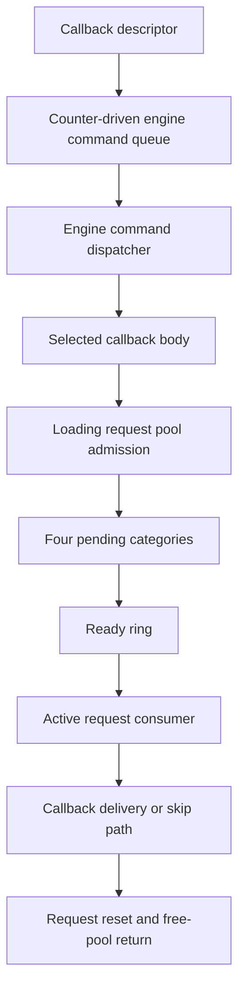

# Engine commands and downstream request lifecycle

This guide connects the recovered command and request paths relevant to a future
mod-command API. It describes one concrete callback caller and a shared downstream
loading-request mechanism. The engine command queue and loading request owner
are distinct objects. It is not a general safe-mutation API, a complete scheduler,
or evidence of original-engine equivalence. Most checks described here are static
analysis or original-instruction emulation with labeled adapters. The lock-target
identification below adds one read-only live observation; queued request execution
has not been validated live through this observer.

## Connected path



The selected callback body supplies a second callback and context to the downstream
request. Successful callback delivery can release and free that context. Other
paths skip it. The paths' local connections are established, but a single complete
concurrent execution from the initial producer through final cleanup has not been
validated. Request preparation, opaque handlers, construction, cancellation and
shutdown remain explicit boundaries.

| Stage | Runnable reconstruction | Evidence and limitation |
| --- | --- | --- |
| Initial publication | `engine.callback_commands` | Full initial ring can drop a descriptor while increasing dispatch budget, leading to cached callback repetition |
| Engine command execution | `engine.command_executor`, `engine.command_drain` | Multiple entry paths; execution byte is not a recursion-safe drain indicator; some queues have quotas/time budgets |
| Selected caller follow-up | `engine.command_related_selection`, `engine.command_related_handler` | Related-record updates can precede failed downstream admission; they are not a callback completion wait |
| Request admission | `admit_pooled_request` in `engine.command_related_handler` | Obtaining a work record and returning from initializer/publisher does not prove eventual delivery |
| Pending/ready transfer | `engine.request_pending` | Four-category scan; resource preparation ends a pass; counters may advance without insertion |
| Active processing | `engine.request_consumer` | Callback codes 0/1/2 and multiple skip paths; active clears before recycle; signal also occurs without callback delivery |
| Selected context cleanup | `engine.request_context_cleanup` | Releases references and frees the supplied context on this callback's normal path; not universal cancellation cleanup |
| Record reuse | `engine.request_recycling` | Clears callback/context fields; no direct context free; free-ring accounting can diverge under supplied capacity pressure |

These module names and Python interfaces are our design. Native fields, routines
and verification receipts are documented in the linked detailed sections below.

## Loading owner and execution route

A static ownership audit now connects the downstream request owner to the named
`Loading Thread`. This is stronger than guessing from neighboring strings:

- Initialization allocates an object of size `0x338`, calls its constructor, stores
  it in the downstream singleton, and passes the name `Loading Thread` to thread
  setup with value 3.
- The constructor installs the vtable whose slot `+8` is the thread wrapper and
  whose slot `+0x10` is the run method. Nearby profiling labels identify
  `::Engine::Loading::LoadingThread::Init` and `ThreadRun`.
- The wrapper writes the object's thread classification into TLS and invokes
  slot `+0x10`, between the `+0x18` and `+0x20` virtual hooks.
- The run method directly invokes the same request consumer already reconstructed
  here. Thus the downstream callback has an established loading-thread route;
  it is not automatically a physics-phase callback.

Readable run-method pseudocode, omitting profiling and TLS setup:

```text
configure_thread_service(1)
while not owner.stop:
    old = atomic_fetch_add_i32(owner.wake_counter, -1)
    # Native CMP/JNS: test the sign of wrapped (old - 1), not signed old < 1.
    if sign_bit(wrap_i32(old - 1)):
        wait_service(owner.wake_event)
    auxiliary_service(owner)
    prepare_requests(owner)
    consume_requests(owner)
    global_followup_service()

if owner.active_request:
    lock(owner.request_lock)
    request = owner.active_request
    owner.active_request = null
    recycle_request(owner, request)
    unlock(owner.request_lock)

lock(owner.shutdown_registry_lock)
for index in reversed(range(initial_shutdown_callback_count)):
    # Registry base is reloaded before each indirect call.
    call(owner.shutdown_registry[index].callback)
unlock(owner.shutdown_registry_lock)
```

The outer loop does not recheck stop immediately after its wait. The consumer has
its own stop gate. The shutdown active-record path recycles without directly
calling the selected request callback. This reinforces the distinction between
record retirement and context cleanup. Shutdown callback ownership, registry
mutation and wait-service semantics are not yet reconstructed.

Evidence anchors for this build: initializer `0x11a2060`, constructor
`0x1188980`, vtable `0x28f1608`, wrapper `0x11e98f0`, run method `0x11ba990`,
consumer `0x1199a20`. These are research identifiers, not portable API constants.
The [static audit receipt](../../native/snow_host/loading_request_owner_validation.json)
records fresh-image span hashes and direct calls. This is not a live thread-ID
capture, emulated run-loop validation, or proof of exclusive thread affinity.

For mod integration, retain the engine command dispatcher as a separate candidate
execution boundary. Qualify its thread and held locks directly. Use this loading
path for resource-lifecycle research; do not route generic player mutations through
it solely because it can deliver a callback.

## What a mod receipt must distinguish

An API must separately report or qualify:

1. Whether the command descriptor actually entered its first queue.
2. Whether dispatch occurred, including repeated-delivery handling.
3. Whether a downstream work record was obtained and published into a pending ring.
4. Whether that request reached ready and active processing.
5. Whether its callback ran or a skip/alternate path occurred.
6. Who still owns the context and whether cleanup completed.
7. Whether the pooled record was reset and returned for reuse.

An event signal, zero execution byte, counter value or recycled pointer proves
none of this sequence by itself. Native work addresses need a generation or other
independently retained identity. Context and callback code must remain valid until
their documented ownership ends. No broad mutation permission follows from being
inside a callback; its thread, held locks and conflicting subsystem work still
need qualification.

## Native observation callback preparation

`native/snow_host/snow_command_observation.h` and `.c` provide an authored,
read-only kind-3 descriptor. Initialize one stable observation owner and caller-
owned record buffer, then retain them and the code for every possible delivery.
The descriptor source itself may be copied. This module does not publish into a
native queue or install a hook. Admission is still a separate unresolved contract.

The invoker records caller return address, thread provider value, entry/exit ticks,
receiver and descriptor-storage identity through `snow_delegate_trace`. The result
field is our supplied request ID, not an engine operation result. Multiple records
with the same ID are intentional: native queue behavior can repeat a cached
callback. Recording exhaustion increments a drop counter; it does not block the
callback. Close stops new recording, while retained late invocations still return.
Drained permits reading records; it does not permit freeing callback storage or
unloading code. Exceptions and nonlocal exits are outside the normal-return model.

The [compiled observer receipt](../../native/snow_host/command_observation_validation.json)
compares the original dispatcher and lock getter with our compiled Windows x64
observer in emulation. Twelve cases cover all four context tags and capacities
0/1/3, four supplied deliveries followed by one after close. The descriptor source
is overwritten after copying. Recorded caller RVA matches the kind-3 return site
`0x662b34`; record-storage identity is the dispatch copy, not the original source.
Lock services and thread/clock values are supplied. This establishes ABI plumbing,
not live thread identity, phase, exclusion, native admission or unload safety.

The [connected pipeline receipt](../../native/snow_host/command_observation_pipeline_validation.json)
extends this to 72 original-instruction cases through producer, descriptor copy,
preparation prefix, counted consumer, cleanup and dispatcher. Each submission has
its own retained observer and request ID. Queue capacities 1/2/4, submission counts
1 through 6 and all four context tags are supplied; 44 cases exercise overflow.
For capacity 2 and four submissions, the observed ID sequence is `1, 2, 2, 2`:
IDs 3 and 4 were not inserted in the constructed state, while ID 2 is dispatched
three times. The recorder uses the same consumer-local descriptor address for
distinct IDs. It must not use that address as request identity.

`engine.command_observation.summarize_deliveries` groups copied records by the
observer's authored request ID. It reports repeated delivery, observed threads,
unknown IDs, recording loss and shared temporary storage without emitting raw
addresses. Absent IDs remain `not_observed`, even with zero recording drops:
publication rejection, pending work or capture closure cannot be distinguished
from the capture alone. It does not infer a safe phase, admission receipt, drain
or unload permission. This authored interpreter is checked against all 72 cases.

```sh
python3 -m engine.examples.command_observation_probe
```

This runnable example uses synthetic records illustrating the validated pattern.
It does not contain or replay captured game memory.

The inspected lock wrappers load a pointer and transfer into `.upx0` code. Those
targets contain bytes in the analyzed image. Their section name and unusual
control flow do not by themselves identify a packer, virtualization scheme or
anti-debug mechanism. The later live target identification and emulated recursion checks below qualify
these specific helpers without proving general mutation safety.

Run the portable C plumbing fixture through:

```sh
python3 -m unittest discover -s tests -p test_command_observation_native.py
```

For a future live pass, first qualify publication capacity under the queue lock,
retain owner/code for cached repetitions, and record actual thread ID and caller.
Keep capture bounded and perform no gameplay writes. The callback return site
identifies the dispatcher branch; it cannot distinguish frame versus transition
entry into the executor without additional enclosing provenance.

## Encoded lock-wrapper targets

The two opaque helper paths can now be reduced to target-decoding thunks for the
inspected image. An initial bounded trace of the unchanged image reaches invalid
instruction-fetch targets after 54 and 64 instructions. Each path performs one
image-data read from an encoded target slot. This failure is a static-image result,
not a native game crash or evidence of an anti-debug response.

The recovered local behavior is:

```text
enter_helper(wrapper):
    argument = read_u64(wrapper)
    encoded = read_u64(image_base + 0x3d9bc2d)
    target = (encoded + 0x796e0b07) modulo 2^64
    tail_transfer(target, first_argument=argument)

leave_helper(wrapper):
    argument = read_u64(wrapper)
    encoded = read_u64(image_base + 0x3c7a1b2)
    target = (encoded + 0x7b907d10) modulo 2^64
    tail_transfer(target, first_argument=argument)
```

The [original-instruction receipt](../../native/snow_host/lock_thunk_validation.json)
covers 96 cases, 48 per helper, with eight supplied target addresses, varying
pointees, randomized general-purpose registers and six flag patterns. At the
synthetic target, the first argument, original return address, stack pointer,
general-purpose nonvolatile registers and flags match expectations. A returning
stub reaches the original caller. All visited instruction spans are hashed.
Target slots are deliberately replaced in the emulator; this is not live import
resolution. SIMD state and alternate image bases are not tested.

`engine.lock_target_observation.decode_target` implements the recovered modular
addition and is checked against these cases. `observe_lock_targets` reads both
slots twice using a supplied reader, at most four reads and 32 bytes. It refuses
short or failed reads and withholds targets if the samples differ. Equal samples
are not atomic or proof of lifetime. The returned addresses are session-private;
do not publish them as portable constants or raw memory captures.

This reduces the next live check to reading those slots, decoding the targets,
and resolving them against the process's current modules and exports. A lower
user-address-range target is not proof of executable memory or API identity.
The slot initialization/writer remains open. The live target resolution and
recursion checks below supersede the earlier identity uncertainty for this one
Wine build/session. Names alone would not have been sufficient.

## Live lock identity and guarded publication

A [read-only live session](../../native/snow_host/lock_target_live_validation.json)
resolved the decoded targets to Wine `ntdll.dll` exports:

| Helper | Exact export | Observed module RVA |
| --- | --- | --- |
| Enter | `RtlEnterCriticalSection` | `0x21fe0` |
| Leave | `RtlLeaveCriticalSection` | `0x2b540` |

The reader checked PID and creation identity on each request. Both decoded slots
were stable before and after module resolution; each target's first 32 bytes
matched its on-disk module implementation. This is one session at scheduler
readiness, not a full in-memory module hash or a live callback/submission test.
The probe did not call the targets or send movement input. The bottle stopped;
saves/settings were restored and the original input DLL was verified.

Windows critical sections permit repeated acquisition by the owning thread with
one release required per acquisition. See [Microsoft's contract](https://learn.microsoft.com/en-us/windows/win32/api/synchapi/nf-synchapi-entercriticalsection).
For the observed Wine module specifically, the original game thunks composed with
its actual lock implementation also pass [emulated recursion checks](../../native/snow_host/recursive_lock_validation.json)
at depths 1/2/3/8. The fixture supplies a same-thread TEB and an initialized
spin-zero critical section. Lock count, recursion count and owner balance on
release. Contention, wait/wake, destruction and exception paths are excluded.

An initial **authored admission candidate** was tested around the original
producer in 18 serial instruction cases. It is now superseded: keeping its outer
lock through producer cleanup changes the original lock order, as explained below.
This historical pseudocode is not the current adapter:

```text
# Preconditions: verified live build, ordinary producer route, retained manager,
# valid initialized lock/array, retained descriptor context and callback module.
acquire(manager.queue_lock)
if manager.queue_count >= manager.queue_capacity:
    release(manager.queue_lock)
    return not_submitted_full     # Do not call the native producer.
call_original_producer(manager, descriptor, alternate_route=false)
# Producer recursively acquires/releases this same lock.
release(manager.queue_lock)
return submitted                 # Not a callback completion receipt.
```

Capacities 1/2/4 and 1 through 6 attempted submissions leave queue count and
pending budget equal to the number admitted. This avoids the tested full-ring
budget increment for **this submitting adapter** by refusing before the native
call. It does not repair other producers that submit when full, establish exactly-
once delivery, or prevent earlier counter/queue divergence. A concurrent consumer
and lock destruction were not exercised. Counter transfers and all competing
producers must still be audited before promising reliable publication.

Do not acquire the separate dispatch lock as part of this guard. Lock ordering,
manager lifetime, module pinning, and the thread/phase where callbacks execute
remain separate requirements. The next native experiment can use this qualified
recursive-lock identity to prepare a bounded, observation-only submission adapter;
it must not infer permission to mutate gameplay or unload after one callback.

## Native guarded-admission adapter

`native/snow_host/snow_command_admission.h` and `.c` now use the recovered record
copy and cleanup helpers, rather than calling the complete producer inside an
outer queue lock. The binding supplies retained manager storage, verified
enter/leave/copy/cleanup functions, the build's default holder and a bounded
identity check. The check runs under the queue lock; it cannot establish that the
lock storage was safe to acquire. Lifetime retention is a precondition.

The initial nested-producer adapter changed lock ordering. In the original
producer, temporary cleanup follows queue unlock. Its two default-holder decrements
can reach a zero low-24-bit count and call the resource release helper. That helper
acquires a separate manager lock **before** checking the holder's suppression bit
26. A suppressed destructor therefore does not mean no additional lock is acquired.
The initial high-count fixtures missed this boundary. This establishes a changed
lock order, not proof of an actual observed deadlock.

The corrected authored adapter follows this structure:

```text
copy descriptor into caller-owned temporary value
acquire(queue_lock)
validate binding and ring fields
if invalid or full:
    release(queue_lock)
    return refusal
construct temporary kind-3 record with two default-holder references
copy_record_into_ring(destination, temporary)  # original helper; retains holders
advance queue count/write cursor
atomic_increment(deferred_budget)
release(queue_lock)
cleanup_temporary_record(temporary)           # original helper; may acquire resource lock
return submitted
```

The 104-byte temporary record has kind 3, default holders at +8/+16, the descriptor
at +24 and no associated reference at +96. Unused fields are authored zeroes. No
source context or callback-module lifetime is retained by this layout. The ring
lock covers publication; it is released before temporary cleanup. Full refusal
makes no temporary-holder release or budget change. That refusal behavior is an
authored correction, not the full-ring behavior of the original producer.

Statuses distinguish `SUBMITTED`, `FULL`, `INVALID_BINDING`, `STALE_BINDING` and
`INVALID_RING`. `SUBMITTED` reports publication and normal return from temporary
cleanup, not callback delivery. Exceptions/nonlocal exits are not caught. Binding
and descriptor inputs must remain immutable during the call; callback context and
code must survive every possible later delivery.

The older [nested-producer receipt](../../native/snow_host/command_admission_validation.json)
is preserved as limited historical evidence. The current
[cleanup-order receipt](../../native/snow_host/command_admission_cleanup_validation.json)
executes the compiled Windows adapter with original copy/cleanup/release helpers,
game lock thunks and observed Wine critical-section routines. All 90 supplied cases
match successful original-producer publication in meaningful kind-3 record fields,
queue/cursor/budget fields, holder counts and final lock state. The fixture compares
capacities 1/2/4, 1 through 6 submissions, three synthetic holder-count boundary states with bit 26
set and two actual words observed in the live interval described below. Across adapter and reference paths, 140 resource-release helper calls occur
with the queue lock released. Payload destruction, concurrency and exceptions
remain excluded; unspecified record bytes are not claimed equivalent.

```sh
python3 -m unittest discover -s tests -p test_command_admission_native.py
```

This adapter is not installed live. A bounded direct-reference scan of the command
singleton found readers but no direct writer. That does not establish permanent
storage or exclude indirect writers/destructors. Manager teardown, competing
producers, counter transfers and callback phase remain live-integration gates.

## Connected admission-to-observation validation

The [connected compiled pipeline receipt](../../native/snow_host/command_admission_delivery_validation.json)
joins the current C admission adapter and C observer through original preparation,
counted consumption, dispatch and record cleanup. The lock helpers run through the
observed Wine critical-section implementation with a supplied TEB/thread identity.

Across 72 serial cases (capacities 1/2/4, 1 through 6 attempted submissions and all
four context tag values), each admitted request ID produces one captured callback;
refused IDs produce none. Overwriting the descriptor source after publication does
not change delivery. A second zero-budget drain creates no new records. Every
record has the expected kind-3 dispatcher return site and receiver. Callback clock
and thread probes execute with the dispatch lock held and the queue lock released.
All queue/resource/dispatch lock states return to their initial unlocked state.

This is an end-to-end **local instruction composition**, not live callback delivery
or a universal exactly-once contract. The fixture retains all owners/code, starts
with empty queues and includes no competing producers or interleaved counter
transfers. Preparation stops after its empty participant traversal. Clock, thread
provider and binding validator are supplied; actual engine phase is not identified.

The integrated consumer additionally reaches the resource-release helper with the
queue lock held in 144 supplied boundary occurrences. Earlier producer-only
fixtures did not exercise this path. Consequently:

- Releasing the producer's temporary record after unlocking preserves that
  producer's local order; it is not a global engine prohibition on nested locks.
- The old outer-producer wrapper changed a local order, but these results do not
  establish that it caused a deadlock or introduced a globally new lock edge.
- Native consumption requires a broader lock-order graph and lifetime analysis.

The manager ownership search also now includes nearby globals and leaf wrappers
missing from unwind metadata. A descriptor wrapper at `0x653620` merely remaps
arguments, reloads the singleton and tail-calls the producer. It provides no pin
or generation token. No manager writer/lifetime mechanism was established by
these bounded searches; absence from the search is not evidence of permanence.

## Live manager storage and queue state

A [read-only live interval](../../native/snow_host/command_manager_storage_live_validation.json)
contains 20 PID/creation-guarded samples while the host-reported engine step count
advances by 275. Manager, critical-section and array pointers and capacity remain
equal across those samples. Capacity is 3072; count, active and deferred budgets
stay zero. Read/write cursors stay equal and unchanged. No command or movement
input was submitted.

All three addresses belong to `MEM_PRIVATE`, `PAGE_READWRITE` regions: 64 KiB for
the manager and lock, 320 KiB for the array. These are containing-region sizes,
not object sizes or proof of a particular allocator. Executable-module pinning
would not pin these allocations. Sampled stability does not close the ownership,
invalidation or destruction questions.

The shared default-holder word varies across seven observed values bounded by
`0x807fffe1` and `0x807fffff`, with bit 31 set and bit 26 clear. The observed
endpoints extend the original-instruction admission comparison to 90 cases; they
are fixture inputs, not immutable configuration. The portable C fixture also
checks final-slot wrap at capacity 3072 using full backing storage.

The session stopped normally; saves/settings were restored and the original DLL
verified. Private-allocation lifetime and callback phase remain open. An empty
queue during this interval does not by itself establish safe native submission.

## Command-manager initialization contract

Searching for the live capacity, 3072, identifies a constructor-shaped routine
at RVA `0x647650`. Its layout matches the observed manager across both budget
pairs, the primary ring, participant container, execution flag and auxiliary
buffers. This is a static layout attribution, not a captured native constructor
call or proof of singleton ownership.

The [constructor fixture](../../native/snow_host/command_constructor_validation.json)
executes the original constructor and ring-allocation helpers in five cases:
all allocations succeed, then each of four allocations independently returns
null. Lock initialization, allocator services, container initialization and empty
buffer cleanup are synthetic. Every case returns the receiver; this does not
establish that the native allocator returns null rather than throwing or exiting.

Recovered initialization, with descriptive names chosen for this reconstruction:

```text
initialize(manager):
    initialize_lock_wrapper(manager + 0x00)
    zero_ring_header(manager + 0x30)       // pointer and four u32 fields
    allocate_primary_ring(manager + 0x30, 3072, record_bytes=104)
    manager.active = 0                   // +0x50
    manager.deferred = 0                 // +0x54

    initialize_lock_wrapper(manager + 0x58)
    zero_ring_header(manager + 0x88)
    allocate_secondary_ring(manager + 0x88, 4, record_bytes=16)
    manager.secondary_active = 0         // +0xa8
    manager.secondary_deferred = 0       // +0xac
    initialize_container(manager + 0xb0, 0)
    manager.executing = false            // +0xbc

    initialize_lock_wrapper(manager + 0xc0)
    initialize_container(manager + 0xf0, 0)
    initialize_empty_buffer(manager + 0x100, ownership_byte=1)
    initialize_lock_wrapper(manager + 0x120)
    initialize_container(manager + 0x150, 0)
    initialize_empty_buffer(manager + 0x160, ownership_byte=1)
    allocate_buffer(manager + 0x100, 128 * 104)
    allocate_buffer(manager + 0x160, 128 * 104)
    return manager
```

The primary ring helper at `0x659170` requests `capacity * 104` bytes, writes
its returned pointer, and sets capacity to the requested value on success or zero
on null. Successful allocation sets the byte at ring-header `+0x18` to one.
The four allocation sizes are 319,488, 64, 13,312 and 13,312 bytes. The primary
request fits the previously observed 327,680-byte containing region; region
size still does not identify the allocator or an exact allocation boundary.

The lock-wrapper initializer's visible prefix stores `wrapper + 8` into the
wrapper's first pointer before calling an encoded target. This suggests inline
critical-section storage, but the target's initialization semantics were not
executed by this fixture. Do not infer a separate lock allocation merely from a
memory-region report.

A bounded direct-relative-call search found no caller of this constructor in the
inspected image. Indirect calls, transformed call paths and startup-only code
remain candidates. The next ownership search can now start from this constructor
and its buffer teardown counterparts, rather than only singleton readers.
No lifetime pin or safe native publication point follows from initialization alone.

## Inline lock storage and initializer target

Re-examining the existing 20-sample live capture establishes `lock == manager + 8`
in every sample. This agrees with the initializer's visible pointer assignment;
it is not a new live session or evidence that the allocation cannot disappear.

The [initializer instruction fixture](../../native/snow_host/lock_initializer_validation.json)
now traces and validates the encoded call in 48 supplied-target cases:

```text
initialize_lock_wrapper(wrapper):
    wrapper.pointer = wrapper + 8
    target = u64(read_u64(image_base + 0x37ede4a) + 0x5a0d734c)
    target(wrapper + 8, 4096, 0x02000000)
    return wrapper
```

The target transfer returns to RVA `0x1c367c1`, bypassing the intervening `hlt`
byte in this inspected path. All tested nonvolatile integer registers survive.
Three supplied target addresses, four register seeds and four initial flag words
exercise the thunk. Synthetic callees return success; SIMD, relocation and native
initialization semantics remain untested. The unchanged image's target slot does
not itself resolve to a valid callable destination. Do not name a Windows API
from its apparent argument shape alone.

`observe_lock_targets(..., include_initializer=True)` now reads all three slots
twice, at most six reads / 48 bytes. The default remains enter/leave only, four
reads / 32 bytes. The subsequent live observation below resolves the initialization target
against loaded modules and exports without calling it.

No absolute constructor function pointer was found in the inspected mapped
image. The bounded relative-displacement search within unwind-described code
found singleton readers but no constructor reference or singleton writer. These
search exclusions do not establish permanence or rule out indirect/transformed
startup paths. Manager ownership and shutdown remain open.

## Live initialization API identity

A [read-only Wine session](../../native/snow_host/lock_initializer_live_validation.json)
resolves the new initializer target exactly to `kernel32.dll!InitializeCriticalSectionEx`,
module RVA `0xe708`. The first 32 target bytes match the installed module file.
Enter and leave again resolve to the previously observed `ntdll` critical-section
exports. All three slots remain equal across the before/after observations.

Combined with the instruction fixture, the recovered call is:

```text
wrapper.pointer = wrapper + 8
InitializeCriticalSectionEx(wrapper + 8, 4096, 0x02000000)
return wrapper
```

The inspected MinGW-w64 14.0.0 `winnt.h` names `0x02000000` as
`RTL_CRITICAL_SECTION_FLAG_DYNAMIC_SPIN`. That header label does not prove how
this Wine implementation handles the flag or how many spins occur in practice.
The wrapper does not test the API return value on the inspected normal-return
path; the fixture supplies success and does not model initialization failure.

The probe made 15 guarded reads totaling 192 bytes across encoded slots and code
prefixes. It did not call these functions, send movement input or submit commands.
The session stopped normally with saves/settings restored and the original DLL
verified. This establishes API identity in the observed Wine build, not safe
initialization or deletion of a live manager lock. Ownership, publication,
destruction and synchronization with plugin submission remain open.

## Lock deletion and event-wrapper identities

A [second bounded target-resolution session](../../native/snow_host/lock_lifecycle_live_validation.json)
distinguishes five pointer wrappers that otherwise have similar encoded-call
shapes. The [instruction fixture](../../native/snow_host/lock_lifecycle_thunk_validation.json)
validates 240 supplied-target cases: 48 per wrapper, preserving the caller stack,
flags and nonvolatile integer registers, with `RCX = read_pointer(wrapper)` at
the target. SIMD and ASLR remain excluded.

| Wrapper RVA | Encoded slot RVA | Addend, modulo 2^64 | Observed exported target |
| --- | --- | --- | --- |
| `0x115d480` | `0x3f6fab0` | `0x2b6a317d` | `kernel32!FlushFileBuffers` |
| `0x1221400` | `0x35db73b` | `0x68915110` | `kernel32!CloseHandle` |
| `0x1221410` | `0x3ee2f8e` | `0x1a156938` | `kernel32!ResetEvent` |
| `0x1c370b0` | `0x3f4320b` | `0x0459521e` | `ntdll!RtlDeleteCriticalSection` |
| `0x1c3b570` | `0x3dc7c29` | `0x7ef2492e` | `kernel32!SetEvent` |

Each live target resolves exactly to the indicated export and has a 32-byte code
prefix matching its installed module file. Seven slots, including the existing
enter/leave controls, remain stable before and after resolution. The probe makes
35 guarded reads totaling 448 bytes, calls none of these APIs, and submits no
commands. Cleanup verifies game exit, saves/settings restoration and the original
DLL. Target names do not prove a manager-specific invocation or synchronization
policy.

A direct-relative-call scan finds 479 instruction-boundary-checked calls to the
delete wrapper within unwind-described functions. No manager destructor has been
identified from these calls. A caller at `0x72e0e0` deletes a lock at receiver
`+0x120`, but also releases containers at `+0x1e8` and `+0x1c8` and uses a `0x210`
size in a conditional delete path. Matching a single offset is insufficient to
assign this function to the command manager.

A separate sequence at `0x662570` can now be described more precisely:

```text
call virtual_slot_0x10(global_A)
owner = global_B
owner.byte_0 = 1
owner.byte_0x46 = 0
ResetEvent(read_pointer(owner + 0x48))
if owner.byte_0x58 == 0:
    unresolved_helper(owner)
tail_call unresolved_helper_2(owner + 0x60)
```

This initial description is superseded by the cross-reference below: the
conditional and final helpers already have graph-setup and job-submission
identities in the delegate research. The initial virtual service remains opaque.

## Root submission entry sequence

Cross-referencing [the delegate lifecycle research](SCHEDULER_DELEGATES.md#submission-enables-the-teardown-wait)
identifies `0x11e2ca0` as job submission, including its usage/wait-flag store.
The conditional `0x6968e0` routine installs callable bindings and graph edges,
as distinguished from construction in the same guide. Thus `0x662570` is an
outer root-submission sequence, not a thread wait or teardown routine.

```text
submit_root_sequence():
    call virtual_slot_0x10(global_A)
    owner = read(global_B)                 // after the initial service
    owner.byte_0 = 1
    owner.byte_0x46 = 0
    ResetEvent(read_pointer(owner + 0x48)) // return value is ignored
    if owner.byte_0x58 == 0:               // sampled after ResetEvent
        prepare_graph_and_bindings(owner)
    return submit_job(owner + 0x60)
```

The [independent model](../../engine/frame_submission.py) supplies the unresolved
service bodies explicitly. It does not duplicate or replace the existing job
request reducers. A [48-case original-instruction comparison](../../native/snow_host/root_submission_validation.json)
validates the outer sequence and original encoded ResetEvent thunk, with graph,
submission and API bodies intercepted. Cases vary initial and post-event gate,
API return, submission return, and a changed global owner after the first call.
The native sequence and model agree on service order, flags and returned value.
Three public tests additionally cover nonzero byte gates and supplied-service
failure boundaries; exception behavior is authored, not native evidence.

This connects event reset, optional graph setup and root submission. It does not
establish when the event is signaled, who waits on it, the outer caller's exact
frame phase, or the root owner's lifetime. It does not close the separate command
manager's publication/destruction gap.

A direct-call search yields a caller at `0xd2c63`. Its immediate sequence calls
a receiver's virtual slot `+0x10`, submits through this entry, calls the same
receiver's slot `+8`, then calls `0x6a5230`. This supplies a next caller/phase
lead; those surrounding services and the outer function are not validated by
the 48-case fixture.

## Buffer disposal is not callback delivery

The constructor's auxiliary-buffer cleanup leads to clear routine `0x658470`
and release routine `0x66b6a0`. These establish local buffer behavior, not the
manager's destructor: the bounded relative-call/jump search found the constructor
calling release, and release calling clear, but no manager shutdown caller.

The [original-instruction disposal fixture](../../native/snow_host/command_disposal_validation.json)
checks 200 valid ring states at capacities 1, 2, 4 and 8, including 70 wrapped
cases. It exercises every read cursor and occupancy from empty through full,
with both owned and borrowed backing storage. Allocator lookup/free are synthetic;
record cleanup executes original instructions with null associated references
and holder counts above their destruction threshold.

Recovered equivalent pseudocode for valid ring states:

```text
clear_records(ring):
    first_count = min(ring.count, ring.capacity - ring.read)
    for index in [ring.read, ring.read + first_count):
        cleanup_record(ring.array[index])
    for index in [0, ring.count - first_count):
        cleanup_record(ring.array[index])
    ring.write = 0
    ring.read = 0
    ring.count = 0

release_buffer(ring):
    clear_records(ring)
    if ring.owns_storage and ring.array != null:
        allocation_info = allocator_lookup(ring.array)
        allocator_free(ring.array, allocation_info)
    ring.owns_storage = true
    ring.array = null
    ring.capacity = 0
```

The second segment in clear is inlined cleanup rather than another call to the
cleanup helper. Both segments clear the invoker and release the two holder
references. Non-null associated objects and final-reference resource destruction
have additional paths excluded from this fixture. Unoccupied slots are untouched.
No descriptor callback is invoked; clearing is not draining by execution.

The independent [disposal module](../../engine/command_disposal.py) implements
this valid-ring contract with caller-supplied record cleanup and allocator
services. It matches cleaned-slot effects, allocation events and final headers
in all 200 original-instruction fixture cases. Seven public tests additionally
check wrap order, borrowed storage, empty release, validation and supplied-service
failures. Exception behavior is exposed as partial progress without rollback;
native exception handling is not established. This module is not wired into a
native shutdown hook and does not manufacture cancellation receipts.

Consequences for an eventual mod API:

- Admission and completion must remain distinct receipts. Removing an accepted
  record through disposal does not constitute callback completion.
- These helpers do not supply a plugin-context destruction callback. Do not free
  callback state or unload plugin code merely because the queue appears empty.
- A future shutdown adapter needs the actual owner lifecycle, synchronization and
  explicit cancellation accounting. This local helper does not establish where
  that adapter may safely run or whether shutdown uses this helper at all.

## Inspect the behavior without game files

```sh
python3 -m engine.examples.command_disposal_probe
python3 -m engine.examples.callback_command_probe
python3 -m engine.examples.command_budget_probe
python3 -m engine.examples.callback_followup_probe
python3 -m engine.examples.related_request_probe
python3 -m engine.examples.request_pending_probe
python3 -m engine.examples.request_lifecycle_probe
python3 -m engine.examples.request_recycling_probe
```

These examples use synthetic records and bound services. They make the local
rules inspectable; passing them does not validate the original game's concurrent
execution or authorize native injection/mutation.

## Evidence and next work

- [Initial callback producer and ABI](ANIMATION_CONTEXT_RETIREMENT.md#callback-command-producer-and-abi)
- [Post-submit follow-up](ANIMATION_CONTEXT_RETIREMENT.md#post-submit-follow-up-is-not-a-completion-receipt)
- [Downstream pool admission](ANIMATION_CONTEXT_RETIREMENT.md#related-handler-retention-and-downstream-request-admission)
- [Pending publication and ready transfer](ANIMATION_CONTEXT_RETIREMENT.md#pending-publication-and-ready-transfer)
- [Consumer gates](ANIMATION_CONTEXT_RETIREMENT.md#request-consumer-and-callback-gates)
- [Context cleanup](ANIMATION_CONTEXT_RETIREMENT.md#request-callback-binding-and-context-cleanup)
- [Acquisition and recycling](ANIMATION_CONTEXT_RETIREMENT.md#connected-acquisition-refusal-and-recycling)

Next test one pinned observation callback with explicit admission and completion
receipts at a verified engine phase. Avoid using arbitrary gameplay mutation as
the first proof. Scheduler stepping remains supporting instrumentation; the goal
is reusable lifecycle and subsystem contracts for broader modding. Continue loading
preparation, cancellation and receiver-creation research as a separate workstream.
